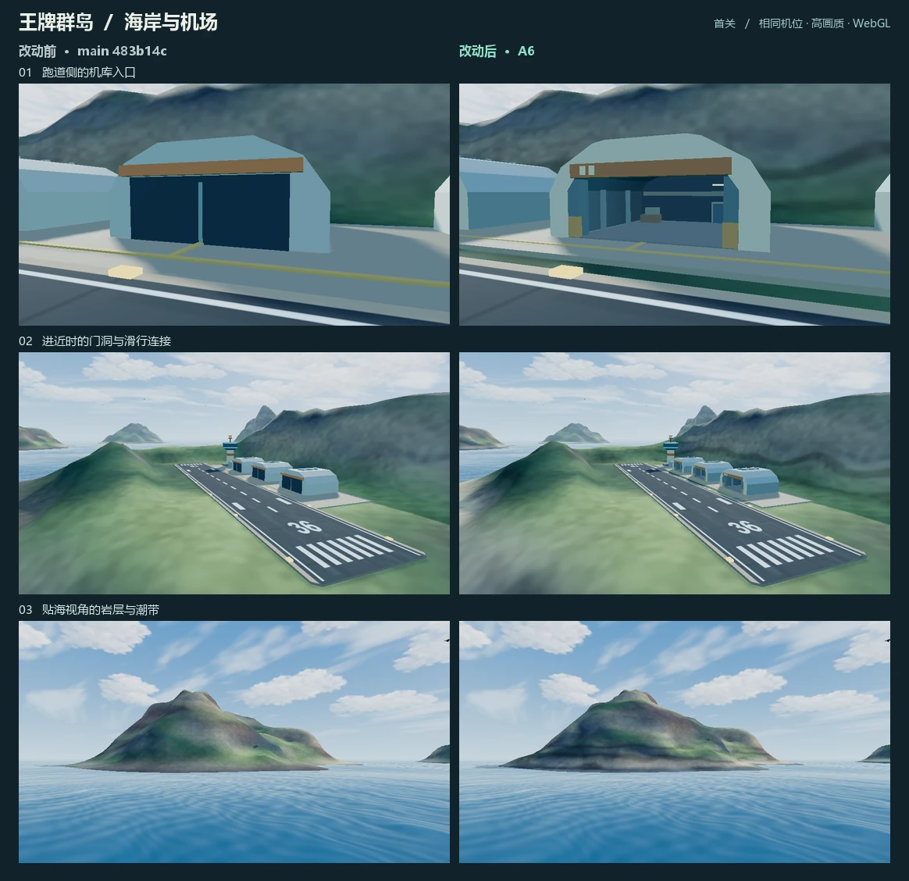

# A6：从海面和跑道看首关

- **从跑道看**：旧库门比门框向外凸 0.525 个场景单位；三个新门洞从门框到后墙都有 24.4 的纵深，能看到两侧立柱、顶板和地面。两条滑行连接跨过草带，未改跑道标号、阈值线或塔台位置。
- **从海面看**：同一迎海断面向内走，先是 18 个单位宽的坡段上升 17.5，再经过 36 个单位宽、仅升高 6.3 的台地，随后 24 个单位内再上升 16.3。邻近背风滩的前 36 个单位只升高 5.5。岩层来自地形本身，海水和高度查询使用同一网格。
- **怎样复验**：运行 `node scripts/test-ace-landmarks.mjs`；`ACE_LANDMARK_SHOTS` 可指定图片目录。回归从模型内外发射检测射线、在同光照下采样实际潮滩，并保存高低画质同机位截图。在低画质对机场和海岬远景分别做一次小幅横移，查局部突变像素；这不等于验证所有航线或真机帧率。每岛仍为 6,272 个三角形，机场仍是 8 次颜色通道绘制。
