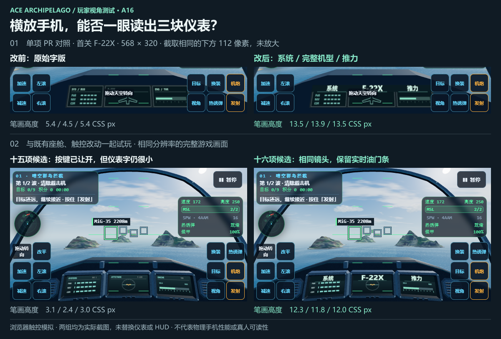

# A16 · 横放手机，读清三块座舱仪表

从机库出击，切到座舱。左屏是系统状态，中屏标出当前机型，右屏显示推力。过去这三行字和刻度一样小，放大截图才能读。在宽大于高、宽 ≤960、高 ≤460 CSS 像素的窗口，游戏改用「系统 / 完整机型 / 推力」或「SYS / 完整机型 / THR」。改的是飞机模型上的标题带，不是贴在镜头上的 HUD。

| 玩家任务 | 验收方法 | 浏览器实测 |
| --- | --- | --- |
| A16 · 读出三块屏 | 568×320、首关、F-22X；从实际眼点测高对比字形的笔画高度，每块屏 ≥7.5 CSS 像素 | 原始面板 5.4 / 4.5 / 5.4 → 13.5 / 13.9 / 13.5；与凹入式三屏模型组合时 3.1 / 2.4 / 3.0 → 12.3 / 11.8 / 12.0 |
| 切语言、换飞机、旋屏 | 三架飞机分别从机库出击，暂停切换中英文；另在手机横屏直接出击 | 油门条随输入变化；回到桌面或竖屏，原字版像素恢复；三块屏以下的刻度、灯条与图标不重画 |
| 保住视野与绘制预算 | 从驾驶员眼点向中央视野投射九条射线；测每次颜色通道绘制，与原模型对比 | 眼点、朝向不改，中央没有实体遮挡；每架机仍为 5 次绘制，持续飞行或同档尺寸变化不再画字或上传贴图 |

复验：`node --test scripts/test-ace-landscape-legends.mjs`。设置 `ACE_SCREENSHOTS` 可保存每个场景的原图和逐屏测量。测量只统计真实文字边界内与背景对比 ≥4.5:1 的像素行，再按实际屏面几何投影；不是把标尺、亮线或纹理字号当作字高。

触控提示挡住仪表是独立的 A15 问题：单独的 A16 不移动按钮，应结合两项检查实机画面。这里的 Chromium 触控模拟不能取代 A9 的首次玩家和真实设备验收。
