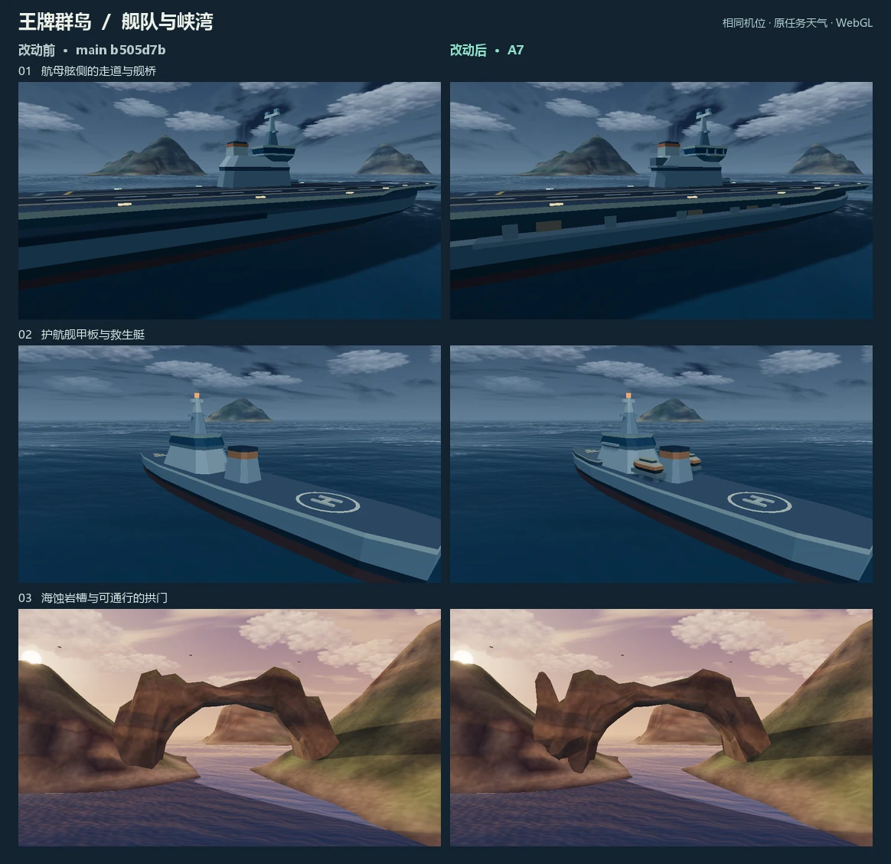

# A7：看得出尺度的舰队与峡湾

- **从海侧看船**：航母飞行甲板下有外伸的走道、支柱和内收的舱壁；舰桥两翼与窗框、转动的天线分层。护航舰前后两段甲板相差 2.25 个场景单位，两侧救生艇安在支架上。在相同的 800 单位距离，去色去标签后，两船在 480×270 的迎面视图分别宽 38、12 像素；上层轮廓一个偏在一侧，一个居中。
- **从峡湾看岩石**：两端拱脚有凸出的岩趾、被海水掏入的岩槽和上缘，左侧有独立可辨的岩脊。实测两处岩槽比上下岩面至少内凹 12.0 个场景单位。沿通道中央和左右各 40 个单位的三条直线均无阻挡；未改地形高度查询、水线、碰撞半径、船速或巡航逻辑。
- **成本和复验**：运行 `node scripts/test-ace-landmarks.mjs`；`ACE_LANDMARK_SHOTS` 可以保留固定机位图片。拱门仍是 1 次颜色绘制。复用同材质静态表面、保留独立的动态部件后，航母和两艘护航舰从 9＋7＋7 次降至 6＋4＋4 次；不含阴影和后处理，不换算为真机帧率。
