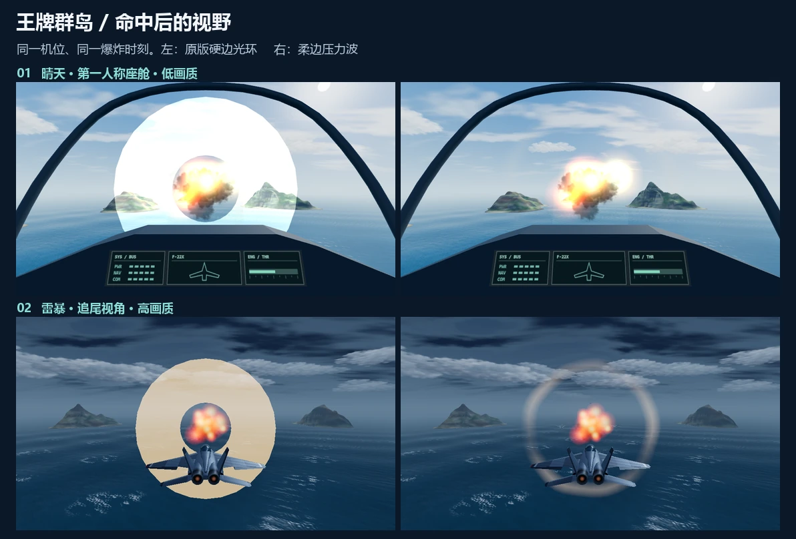

# A10 · 命中以后，仍能看清前方

在首飞触屏回放里，刚打中目标就出现了一大片白环。座舱近景更明显：两侧的岛和地平线会被盖住。把同一帧的冲击波单独隐藏，火球还在，但海岛立即恢复，问题不是弹道、HUD 或天空曝光。

原版每次爆炸生成一个宽环，从正反两面做加色混合。新版环只画朝向相机的一面，内外边沿透明，波峰的密度沿圆周变化，用普通透明混合透出原有背景。小型和大型爆炸沿用原扩张倍率和持续时间，外轮廓略有起伏；火球、烟尘、计分和命中判定没有改动。系统启用「减弱动态效果」时进一步淡化这道波，不隐藏命中本身。这不是消除游戏中的所有闪光。

## 同帧对照

Windows / Chromium 151 / Three.js r160，960×540。原版 `e31e00d` 与改版用相同的任务、相机、爆炸和抖动种子。晴天低画质第一人称在前方 100 个场景单位触发小爆炸，观察第 12 次固定步长；雷暴高画质追尾在 250 单位处触发大爆炸，观察第 32 次。三次渲染之间不推进模拟，分别测背景、火球与烟尘、最后再加冲击波。

| 画面（518,400 像素） | 被冲击波显著改变的像素：原 → 新 | 被冲击波新推近纯白：原 → 新 | 火球和烟尘改变的像素：前后相同 |
| --- | ---: | ---: | ---: |
| 晴天座舱 | 103,776 → 4,094 | 76,210 → 0 | 29,534 |
| 晴天座舱 · 减弱动态效果 | 103,776 → 350 | 76,210 → 0 | 29,534 |
| 雷暴追尾 | 72,038 → 33,863 | 0 → 0 | 8,629 |

这里「显著改变」指环开关前后 RGB 绝对差之和 >12；「新推近纯白」只计原先至少一个通道低于 230、加上环后三通道均 ≥245 的像素。雷暴本来就不易纯白，故同时检查改变面积，并要求火球和环仍有可见像素，不能通过删除效果达标。

低画质下一道波的颜色绘制从 2 次变成 1 次。共享一个 192 三角形的静态网格，不添加纹理；每道波仍有独立淡出的材质。两个重叠爆炸中小波先消失，大波不受影响；重开时两份材质均已释放，下一场复用同一网格。复验：`node scripts/test-ace-lighting.mjs`；`ACE_SCREENSHOTS` 下的 `lighting/` 包含三张原始画面和 `impacts.json`。这些是固定场景的渲染读数，不是真人舒适度评分或真机性能结论。
