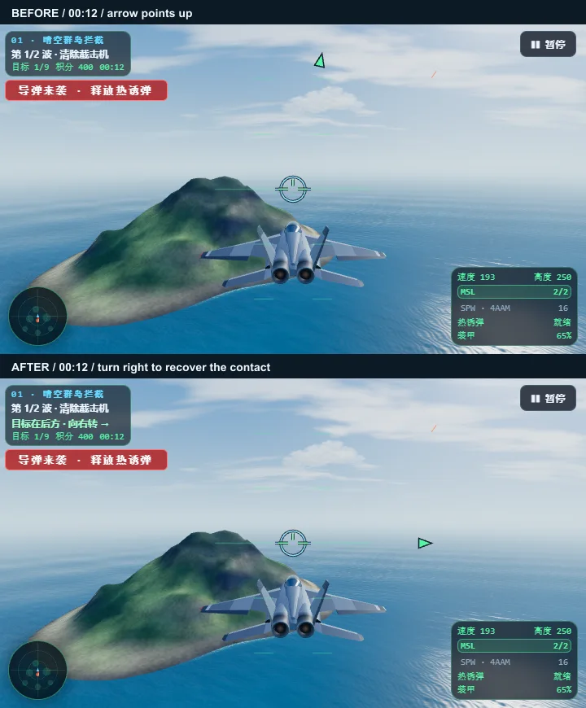

# A11 · 飞过目标后知道往哪儿转

第一关第一次命中后继续直飞，到任务钟 00:12，目标还在，却没有可追的方框。基线 `b908385` 的这帧里，目标相对镜头水平偏角是 174.9°，几乎在正后方；绿色三角却从屏幕向右的方向上仰了 77.9°，看起来像是让人继续抬头。修复后，三角水平指右，并写明「目标在后方 · 向右转」。两帧中的玩家与目标坐标、生命和计分进度一致；不帮玩家转向、选目标或判定命中。

- 目标在视野外才出现一行指引。前方飞出视野时提示左右、上下或斜向；较远偏向身后时，明确提示往哪边掉头。几乎正后方时两边都可转，保留上一次建议，不随相机轻微抖动来回切换。
- 重新看见选中方框，提示即退场。短触屏横屏只在任务栏内给方向，不把第二个箭头画进仪表或按钮；暂停和重开也不留上局提示。
- 复验：`node scripts/test-ace-navigation.mjs`；设置 `ACE_SCREENSHOTS` 可保留追尾、座舱和雷暴横屏截图。方位边界单独用受控相机坐标检查，结束即还原。实际首关流程不改位置、速度、血量、计分或弹药：第一次命中后用原有换目标键选中下一架，依可见方向提示操控，方框返回后再对准并登记第二次碰撞命中。
- 用例采用固定游戏步长、真实键盘/触屏事件和抽样 WebGL 画面。任务钟不是玩家现实耗时；这不替代三位新玩家及实际手机、集显的验收。
