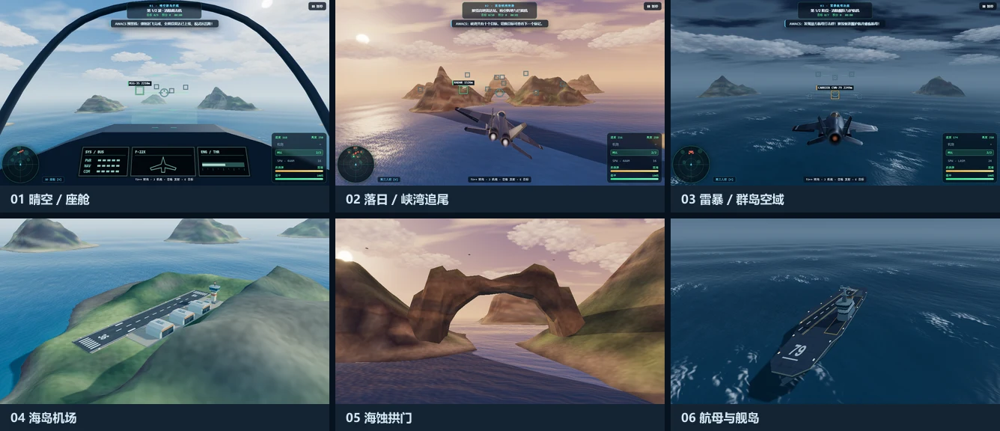

# 王牌群岛：3D 资产清单与回归验收

玩家首飞记录、建模优先级及逐项验收标准见[玩家体验与画面任务表](ace-player-polish.md)。

审查基线：PR #42，`e09ae3b`。范围是《王牌群岛》的程序化场景、运行时、输入和进入游戏的路径，不是合集里的另外三个游戏。所有关卡都要在实际 WebGL 上看，不能以“对象创建成功”代替画面验收。

上排为游戏相机，下排为同一场景使用验收相机拍摄的地标近景。首页预览是从机库出击后用键盘加速、滚转时截取的真实游戏画面。

| 对象族 | 游戏内出现位置与内容 | 验收关注点 |
| --- | --- | --- |
| 光照、天气、环境反射 | 三套天空穹顶参数、太阳盘/光晕、高空卷云与积云实例、雷暴闪电、日光/半球光、阴影、雾、天空 IBL、Bloom/输出变换 | 晴空、落日和暴风可辨。移动和切画质时光向、接触阴影、天空/海面的地平线连续；低画质不依赖辉光来辨认物体。 |
| 海面、地形 | 动态海面、波峰、太阳反光、浅滩、岸边白沫、舰尾航迹；火山岛、海滩、山脊与岩壁 | 波纹不跟着相机滑动；模型不悬浮或被埋；水面和陆地能提供速度与高度参照。 |
| 地标与舰队 | 首关跑道、机库、塔台和信标；峡湾石拱、雷达站与地面阵地；末关航母、甲板标记、舰岛、雷达、驱逐舰 | 从正常飞行距离看得出不同轮廓；近处检查建筑与地貌交界、甲板与海平面。石拱中间要看得清通道。 |
| 机体与座舱 | 三种玩家机体、敌方战斗机、轰炸机、王牌；机身、进气口、翼面、垂尾、舵面、座舱盖、航灯、喷口、尾焰与马赫环；第一人称座舱框架、HUD 玻璃、仪表屏 | 机库、追尾、座舱各看一次；全程前后朝向一致，仪表不遮住前方；用轮廓而非只靠涂色区别机型。 |
| 飞行与命中特效 | 翼尖凝结、掠海水雾、曳光、导弹弹体/光点/烟迹、热焰弹、爆炸火球/烟尘/冲击环 | 高密度时保留实体与 HUD 可读性。烟按景深混合，发光层相加；切关不留下上一局的特效。 |
| 相机与叠层（非 3D 模型） | 机库环绕、追尾、第一人称；雷达、瞄准、目标标签、危险提示、无线电、暂停、结算、触控界面 | 射击、切视角、重试、下一关和返回机库要走真实输入。窄屏测试区分“飞行中调整窗口”和“手机从机库出击”。 |

## 复验方法

1. `npm ci`，再运行 `npx playwright install chromium`。`npm run test:ace` 串行运行 `scripts/test-ace*.mjs` 中的浏览器用例，避免多个软件 GPU 争用同一台机器。跨场景主用例 `node scripts/test-ace.mjs` 直接提供与游戏 import map 同版本的 Three.js r160 模块，无需访问 CDN；渲染器不是模拟对象。
2. 设置环境变量 `ACE_SCREENSHOTS` 指向输出目录，可保留机库、晴天追尾/座舱/热焰弹、黄昏、雷暴和窄屏的实机 PNG。测试从 **WebGL 画布本身** 采样，检查非空对比度及关卡调色，而非对 HTML HUD 截图作颜色断言。
3. 连续循环三架飞机，回到同一机型时比较 `renderer.info.memory`。基线的一次本机采样经两轮切换，几何计数为 **72 → 151 → 224**。这是已提交到渲染器的几何对象数，不是显存字节数。特效测试检查活跃粒子和实例数一致，且重开时不会残留。
4. 独立回环测试页在相同机位生成 100 个烟尘和 100 个辉光实例，读取实际颜色通道绘制统计。保留相同的 400 个三角形，额外 draw call 从基线 **200** 次降为 **2** 次；不含场景本身、阴影与后处理。
5. 实机性能另测：固定机型、分辨率、画质和任务，在同一路段测帧时间，并单独记录爆炸/雷暴与稳定巡航。CI 软件渲染不能证明移动设备帧率，也不能证明商业“3A”水准。

### A4：准星在哪儿，怎样知道打中了

开口十字表示机炮在当前目标距离处会经过哪里，不会吸附到目标。转向时的小圆圈只表示摇杆或鼠标输入。只有目标真正扣血，接触位置才会出现四道短线和「命中 / HIT」；如果接触点已在画外，提示会短暂出现在武器栏旁。切换视角不会把命中标记移到屏幕中心。

复验：`node scripts/test-ace-hud-hits.mjs`。基线 `7bc0c9f` 在 1100×660 追尾视角、前方 500 个场景单位处，屏幕中央的准星与实际轨迹投影相差 47.20 CSS 像素。在 50 ms 步长下，一发穿过测试目标的机炮弹也可能不扣血。修复后，浏览器从真实按键或触控发射，读取实际弹迹和 HUD 画布：五组桌面视口/视角及一个 DPR 2 触控视口的准星误差均小于 0.1 CSS 像素。另用八组摆位分别验证移动、穿过、擦边未中及有效期等边界；命中只扣一次血，未中不提示。摆位用于重现边界，不代表真人命中率或手机实测。

## 本轮集成读数

- 720×405、高画质、固定初始机位和模拟步长，三关连续轮换三遍。环境反射预热后的第 2/3 遍，几何计数分别保持在 60 / 84 / 66，纹理均为 22，同关的绘制次数也未继续增长。这不是全关卡或所有硬件的性能上限。
- 地形采样对照渲染三角面射线、跑道/站点落地和地面投影分别验收；首关受控遮挡测试测到 1,226 个像素变暗。三种玩家战机外部使用 9–10 次颜色通道绘制，座舱为 5 次。
- 战役验收覆盖 9/9、10/10、7/7 结算、下一关和坠毁重试。胜利流程用摆位目标加真实输入、碰撞和计分验证；不等于验证一般玩家自然通关的难度。
