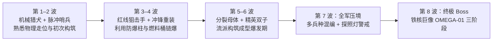

# Iron Core Arena · 铁核竞技场 — 俯视角 3D 机甲动作肉鸽设计与实施方案

> 设计目标：玩家一边把底盘开出危险区，一边让上半身继续盯住原来的目标。计划把 Three.js、程序化机甲与场景、战斗规则、中英 HUD 和 Web Audio 全部装入 `games/ironcore.html`；不依赖外部模型、音频或贴图。下列窗口、数值与性能指标是待试玩的基线。

---

## 1. 产品定位与核心指标

| 项目 | 规格说明 |
| --- | --- |
| **游戏名称** | **IRON CORE ARENA · 铁核竞技场** |
| **文件路径** | `games/ironcore.html`（单文件自包含） |
| **核心体验** | 硬核工业风俯视角 3D 双摇杆机甲动作肉鸽：独立底盘/炮塔力学驱动 + 物理后坐与弹壳弹跳 + 波次三选一构筑 + 巨型 Boss 决战 |
| **目标平台** | 纯桌面端键鼠优先（WASD 八向底盘驱动 + 鼠标 3D 地面激光精确瞄准 + 左右键双武器 + 推进器冲刺无敌帧） |
| **单局时长** | 完整战役约 **5–8 分钟**：前 7 波构筑，第 8 波决战 Boss（不是第 9 波）；通关后可自选无尽超载模式 |
| **世界尺度规范** | 统一采用真实比例：`1 Three.js Unit = 1 米`，八角形重钢竞技场内径 `44 m`，玩家机甲高 `2.6 m`、宽 `2.2 m`，Boss 巨像高 `7.5 m` |
| **语言支持** | 中文 / English 实时切换，与合集首页风格一致 |

### 1.1 第一扇闸门：走位与瞄准是两件事

初次试玩默认选中「先锋」。北闸亮起三道箭头，1.2 秒后猎犬沿地面驶入。第一道提示只要求「向右移动，准星留在北闸」：玩家能看到履带转向东侧、腰环仍朝北。第二波才让悬浮哨兵在另一扇门现身，借机教一次冲刺，而不是开场铺满按键表。

场地提供两种站法：外圈有柱可挡直线火力，但绕柱会失去射击窗口；中心无遮挡，副武冷却时在核心圈内连续站稳 **2 秒**可将当时的剩余冷却减半（每波一次，离圈或受伤中断读条，就绪时不消耗机会）。地板环向内收拢表示充能，不用和敌人的向外扩散危险环共用一个信号。

---

## 2. 精细化 3D 场景构建拆分（分层模块化架构）

为营造类似《Armored Core》工业测试场与《Synthetik》的厚重冷钢质感，竞技场场景拆分为 **5 大结构层级**：

### 2.1 第一层：深渊外围与巨型工业穹顶（Outer Foundry）
- **下沉式炼钢深渊**：主竞技场平台悬架于深 `-14 m` 的工业反应堆深渊之上，下方隐约可见缓缓旋转的巨型涡轮风扇与暗橙色熔炉散热格栅微光，彻底打破“一块地板浮在黑背景里”的单薄感。
- **高耸围墙与悬臂塔吊**：竞技场外圈环绕高 `10 m` 的倾斜防爆装甲壁，外侧矗立 4 座高 `22 m` 的钢桁架探照灯塔、工业排气管（周期喷出上升蒸汽粒子）与高空横梁行车。

### 2.2 第二层：重钢格栅地面与区域功能划分（Arena Deck）
- **多区域程序化钢板地板**：
  - 中心半径 `6 m` 为**超载反应核心区**：嵌入式六角金属格栅（可透视下方蓝色脉冲反应堆）+ 环绕黄黑警戒线 + 激活时亮起的能量充能圈。
  - 中圈为重型防滑花纹钢板（带铆钉、焊缝、履带摩擦划痕与局部油污反光差异）。
  - 外圈 4 个方位设有**机械升降闸门（Spawn Bays）**：每波刷怪前 1.2 秒闪烁琥珀色警示灯并液压滑开，敌人从闸门中真实驶出/跃出，而非凭空出现。
- **地面永久战损痕迹（Persistent Battle Scars）**：激光灼烧焦痕、爆炸熏黑弹坑与机甲急刹焦印通过轻量级贴花对象池（最多 80 个，FIFO 复用）保留在钢板上，越打越有战场厚重感。

### 2.3 第三层：立体掩体与可交互物理设施（Tactical Cover & Props）
- **重型防爆掩体柱（6–8 组）**：采用倒角工字钢 + 混凝土防撞墩 + 顶部红色防撞警示灯拼接，可真实阻挡敌方直瞄激光与实弹，被重火力轰击时迸射金属火花并逐步磨损剥落。
- **可引爆高压燃料桶（Red Hazard Barrels）**：每波在场边补给 3–4 组，受击后先喷射 0.25 秒高压火苗随后剧烈爆炸，对半径 `5.5 m` 内敌军造成高额伤害与物理击飞，可触发相邻油桶**链式引爆**。
- **高低落差斜坡与维修信标**：场边设置 2 处微抬高 `0.8 m` 的装甲检修台，战损后每隔 2 波随机空投 1 个带降落伞减速着陆的绿色纳米维修舱。

### 2.4 第四层：高精可动玩家机甲（Articulated Player Mech）
- **严格分层机械结构**：
  - `底盘组（Chassis）`：宽体履带/四足悬浮基座、后部双矢量推进喷口（冲刺时蓝白等离子尾焰骤然拉长）、底部微弱悬停尘雾。
  - `腰部转盘（Turret Ring）`：独立绕 Y 轴 360° 追踪鼠标落点，带精密齿轮环与散热百叶窗。
  - `双臂/双联武器挂架`：主武器（带独立后坐滑轨与抛壳口）、副武器导弹巢/电磁线圈、肩部动态状态灯（血量越低由青转橙红）。
  - `构筑可视化挂件`：拾取“轨道浮游炮”后，机甲外围真实出现绕轨飞行的 3D 微型武装无人机；拾取“高压特斯拉”后，肩部装配发光电弧线圈。

### 2.5 第五层：高辨识度机械敌群与三阶段 Boss（Enemy Fleet）
- 每类敌人均通过鲜明几何剪影 + 专属发光眼/核心色温区分：机械猎犬（低矮敏捷四足 + 红眼）、脉冲哨兵（悬浮八面体双翼 + 紫晶核）、红线狙击手（高挑三脚架长管狙击台 + 激光瞄准器）、重装盾卫（前倾弧形防爆重盾）、终极 Boss **OMEGA-01**（可独立旋转的肩部双联激光炮、背部散热鳍片与发光过载核心）。

---

## 3. 真实光影、PBR 材质与后处理管线

| 渲染环节 | 具体实现参数与技术选型 |
| --- | --- |
| **动态探照灯与主阴影** | 1 盏冷月工业顶光 `DirectionalLight`（`#cfe2ff`, 强度 `1.6`，`2048×2048` `PCFSoftShadowMap`，紧贴 `±26 m` 竞技场视锥）+ 4 座塔楼动态 `SpotLight` 探照灯（带半透明体积光锥网格），在 Boss 战进入 P3 狂暴时全数切为警报深红并慢速扫射场地。 |
| **真实局部动态点光（Pooled PointLights）** | 预分配 6 盏高频复用 `PointLight` 对象池，动态绑定到**炮口开火闪光、燃料桶爆炸火球、电弧放电与玩家冲刺等离子尾焰**，让暗色钢板地面与掩体侧面实时反射耀眼的橙红与电蓝瞬时光影。 |
| **程序化工业 PBR 纹理** | 离屏 Canvas 生成 512×512 贴图集：拉丝花纹钢板 Albedo + Bump + Roughness（油污处 `roughness = 0.22` 反光锐利，磨损锈迹处 `roughness = 0.85` 哑光），让顶灯与爆炸火光在地面反射出真实高光层次。 |
| **IBL 环境反射与视角纵深** | `PMREMGenerator` 烘焙暗色冷暖对比工业厂房环境贴图，确保机甲金属倒角边缘（`metalness = 0.85`）有清晰高光轮廓；摄像机采用 `FOV = 42°`（减少边缘畸变、增强微缩机械厚重感），高 `24 m` 斜俯 `56°` 跟随，并随鼠标瞄准方向做 `2.5 m` 动态前瞻偏移（Look-Ahead）。 |
| **后处理与降档顺序** | High 用 `ACESFilmicToneMapping` 与轻量辉光；Med 先减弹壳、贴花和点光；Low 关闭 Bloom 与动态阴影，用地面图形保留预警。可回收的是装饰效果，不是还在生效的危险物。60 FPS 是硬件试玩目标，不是对象池本身的保证。 |

---

## 4. 严格物理定理与战斗运动学设计

本游戏的核心爽感来自**扎实可信的机械惯性与打击物理**：

1. **机甲底盘牛顿动力学与悬架倾角**：
   - 设机甲质量 $m = 1200\text{ kg}$，推进力 $F_{\text{thrust}}$ 与速度相关的地面阻尼 $F_{\text{drag}} = -c \vec{v}$ 共同决定加速度：
     $$\vec{a} = \frac{\vec{F}_{\text{thrust}} - c\vec{v}}{m}$$
   - 启动时瞬间响应、松键后有极短的 `0.12 s` 惯性滑行制动；底盘姿态按瞬时加速度实时产生**纵向俯仰（Pitch）与横向侧倾（Roll）**（$\theta_{\text{pitch}} \propto a_{\text{long}}, \theta_{\text{roll}} \propto -a_{\text{lat}}$），急停急转时机械重心转移肉眼可见。
2. **开火动量守恒后坐与物理弹壳抛射**：
   - 重型霰弹与磁轨炮开火时，按动量守恒 $\Delta \vec{v}_{\text{mech}} = -\frac{J_{\text{recoil}}}{m}$ 给机甲施加轻微反向推力，同时炮管执行阻尼弹簧后坐。
   - 每次射击从抛壳口以随机侧向初速 + 旋转角速度弹出 3D 黄铜弹壳，受重力 $g = 9.81\text{ m/s}^2$ 下落，撞击钢板地面后按恢复系数 $e = 0.45$ 弹性弹跳 2–3 次并伴随轻微滚停摩擦。
3. **有界的范围击退**（中心最强、边缘为零）：
   - 燃料桶或重型敌人爆炸时，对半径 $R$ 内所有单位施加径向冲量，大小遵循衰减律：
     $$I(r) = I_0 \cdot \max\left(0, 1 - \left(\frac{r}{R}\right)^2\right)$$
   - 轻型机械猎犬会被直接炸飞翻滚撞向钢墙，重装盾卫则被震退并出现短暂硬直；飞散的金属残骸沿抛物线弹跳后冷却熄灭。
4. **冲刺推进曲线与极限闪避时间膨胀**：
   - `Space/Shift` 冲刺持续 `0.22 s`，速度曲线遵循快速上升 + 指数衰减（峰值速度 $v_{\text{dash}} = 26\text{ m/s}$，是常规移速 $9.5\text{ m/s}$ 的 2.7 倍），期间开启无敌帧与等离子拖影。
   - **极限闪避（Perfect Dodge）**：冲刺开始后前 `0.12 s` 内，有敌方弹丸进入距机甲中心 `1.6 m` 的擦弹圈，才给一次奖励：副武**剩余**冷却减半、播放 `0.3 s` 慢动作。一次冲刺擦过三发也只算一次；没有移动输入则沿上一次移动方向冲刺，开局默认向北。无敌不等于穿墙，撞柱停在柱边。
   - 冲刺、冷却、预警和伤害均按模拟时间计；慢动作表现按未暂停的实际时间计，到时恢复正常倍率。关闭震屏、闪光或声音都不改变判定窗口。
5. **物理级打击反馈（Juice）**：
   - 暴击或击杀精英时插入 `25–45 ms` 局部顿帧（Hitstop）+ 阻尼弹簧相机微震（按冲击方向定向抖动，而非无脑随机乱晃）。

---

## 5. 三款可选机甲、肉鸽构筑与 8 波 Boss 战

### 5.1 三款差异化起始机甲（机库 360° 展示）
| 机甲代号 | 定位 | 生命 / 极速 / 冲刺 CD | 主武器（左键） | 副武器（右键） |
| --- | --- | --- | --- | --- |
| **MK-IV Vanguard · 先锋** | 均衡突击型 | 100 / $9.5\text{ m/s}$ / 2.2s | **双联速射机炮**（高速实弹 + 弹壳飞溅） | **三发追踪微弹**（比例导引弧线打击） |
| **MK-VII Railgunner · 磁轨** | 爆发穿透型 | 85 / $11.0\text{ m/s}$ / 1.8s | **电磁穿透步枪**（瞬发贯穿 + 强后坐） | **高能震荡波**（扇形物理击退 + 清除弹幕） |
| **MK-IX Bastion · 堡垒** | 重装散射型 | 135 / $8.0\text{ m/s}$ / 2.8s | **重型等离子霰弹**（7 弹丸贴脸高爆） | **展开偏转护盾**（正面 2.5s 反弹敌方子弹） |

### 5.2 波次三选一肉鸽构筑（5 大核心流派）
- **弹幕洪流流**：多重弹道（+2 散射）、钢墙弹性反弹（入射角=反射角）、击杀分裂子母弹。
- **电弧连锁流**：高压特斯拉线圈、暴击落雷、冲刺静电新星（3D 折线锯齿电弧动态连接）。
- **无人机编队流**：轨道浮游炮（最多 3 台真实环绕机甲）、自爆巡飞弹、维修纳米虫。
- **炙热过载流**：冲刺火焰尾迹（在钢板上留下持续 3.5s 燃烧带）、灼烧穿甲弹、低血量狂暴。
- **极限机动流**：双重冲刺充能、冲刺发射散射弹、极限闪避重置副武并回复护盾。

**选卡不是另一条经验条**：W1–W7 各在「本波已出完、场上无敌」时冻结战场，给一次三选一；地面晶体只计分，不会让玩家为最后一颗晶体拖住整波。卡面并排写出当前值和选后值，确认一次才开启下一扇闸门。选卡点击不传给武器，回到战场须重新按下才开火。

例如，带「轨道浮游炮」从 `0 → 1` 架开始，继续选它能到 3 架，但也就放弃了这一波的机动升级；满 3 架后不再出现。每手三张不同，先剔除满级或与当前机体不兼容的卡，缺位从通用的装甲、主武增伤、副武冷却三项中不重复补齐（均可跨波叠加）。弹片、灼烧和浮游炮不递归触发同一种生成效果。

### 5.3 八波递进与终极 Boss「铁核巨像 OMEGA-01」

| OMEGA-01 阶段 | 先读到什么 | 怎么应对、何时反击 |
| --- | --- | --- |
| P1：高于 65% | 肩甲先张开，地上出现成对扫线，然后才转动光束；猎犬仍在移动。 | 防爆柱会截断扫线。等光束掠过柱缘，绕出柱后利用收臂空当还击。 |
| P2：降至 65% | 巨像起跳，带刻度的落点圈先收满，再从落点向外推出一道有厚度的环。 | 留一次冲刺穿环；环经过后落点恢复安全，巨像起身时可以靠近。柱子不挡地波。 |
| P3：降至 30% | 胸甲打开，分段警戒环先标出弹幕缺口；即使关闭红灯和震屏也能读出方向。 | 沿缺口移动，把准星留在外露核心。下一轮缺口先标示，再发出弹幕。 |

阶段只前进不回退；同一击跨两道阈值就进入最终阶段，不排队补放旧招。玩家生命归零即失败；玩家存活且 Boss 被击破则清除残余危险物、结算胜利，不再发第八张升级卡。结算可选无尽或新开一局；新局不继承模块、冷却、伤害或地面物件。

---

## 6. 桌面端键鼠操控与 Web Audio 音效

| 操作 | 键位 | 效果说明 |
| --- | --- | --- |
| **底盘八向驱动** | `W` `A` `S` `D` | 镜头平移不绕轴，`W` 始终朝屏幕上方；斜向输入归一化，不因同时按两键而提速。 |
| **炮塔 360° 瞄准** | `鼠标移动` | 准星落在可行走表面（含斜坡），移出场地保留最后有效方向。近侧高墙可淡出，但实体掩体仍挡攻击；指示线在柱前截断，不给穿柱命中的错觉。 |
| **主 / 副武器** | `左键` / `右键`（或 `E`） | 准星外环实时显示副武冷却与冲刺充能 |
| **战术冲刺（无敌帧）** | `Space` 或 `Shift` | 向当前移动方向推进，支持擦弹触发子弹时间 |
| **构筑快捷选卡** | `1` / `2` / `3` 或点击 | 波次结束瞬间升起全息卡片，无缝衔接 |
| **暂停 / 构筑总览** | `Esc` 或 `P` | 可看模块、调画质/音量/震屏。失焦时暂停并清空按住的移动和开火输入，手动恢复回原来的战斗或选卡画面。 |

- **Web Audio 合成音效**：履带和机炮占低频，弹壳落钢板与计分晶体的拾取用短促高音；极限闪避时压低环境声，保留闸门预警。静音不移除地面箭头或擦弹提示。

---

## 7. 第一版试玩与验收

**先做先锋、两扇闸门和 W1→选卡→W2**：让玩家边横移边保持瞄准，亲眼看见第一张卡在第二波产生的效果，再比较「绕柱」与「冲出掩体占核心圈」。灰盒里读不出危险方向时，先修预警与镜头，再扩三台机甲、五类构筑、完整八波及通关后的无尽模式。

| 实现后要测的场景 | 通过条件 |
| --- | --- |
| 底盘、炮塔与掩体 | 在北闸留一个目标，向东横移时底盘位移、炮塔仍指向目标；夹柱冲刺不会穿柱。关闭音效、阴影、震屏后仍能凭轮廓分辨出生闸门与地波。 |
| 擦弹与选卡 | 固定同一波，让三发在一次冲刺窗口内擦过：基础机体只触发一次慢动作、只减半一次剩余冷却；窗口外普通冲刺不领奖。选卡停留时生命、弹丸、冷却不变，双击同一卡只升级一次。 |
| 决战与帧耗 | 同一战役 W1–W7 恰有七次选卡，W8 胜负各只结算一次。固定 P3 场景，1280 × 720 预热后采样 30 秒，记录设备/GPU、画质和 P95 帧时；High 的 60 FPS 预算约 16.7 ms，软件 WebGL 单独记 Low 档可玩性，不拿无头截图声称达标。 |

浏览器冒烟用 Playwright：屏蔽外部请求，检查机库与 W1 均有实景且无脚本或 WebGL 错误；按住主武时切出再回来，不得自动续射；中英、画质切换不清掉已选模块，新开局才清空。

**接入仓库时**：新增 `games/ironcore.html`、`scripts/test-ironcore.mjs` 和 `npm run test:ironcore`；用实机「横移机甲与闸门预警同框」制作 `assets/previews/iron-core-arena.webp`（960 × 540）。HTML/WebP 纳入 Git，更新 `index.html`、`README.md` 及首页卡片断言；集成后再跑游戏检查、`npm run build`、`npm run test:home` 和 `npx cf deploy --prebuilt --mode production --dry-run`。
