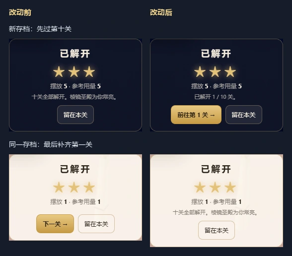
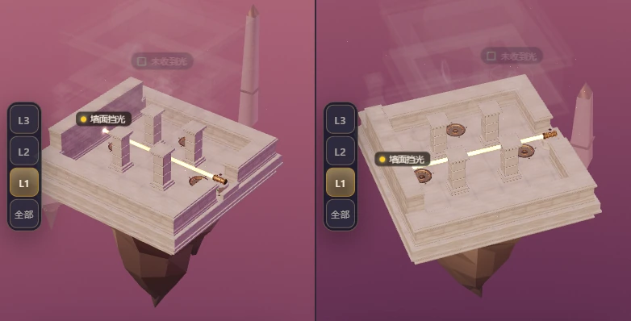
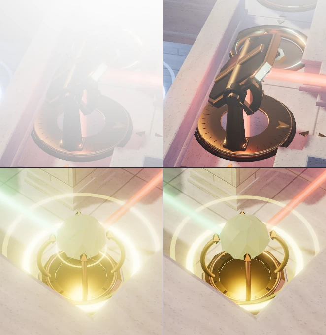
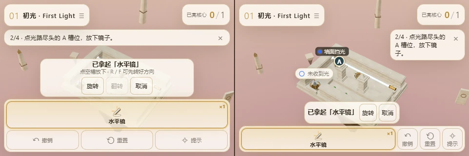
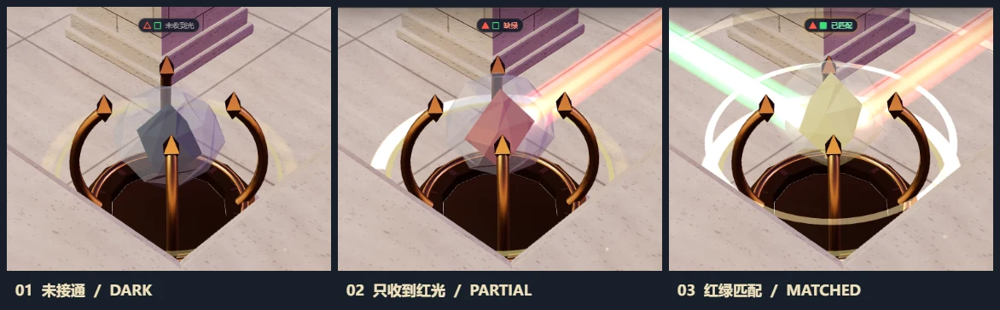
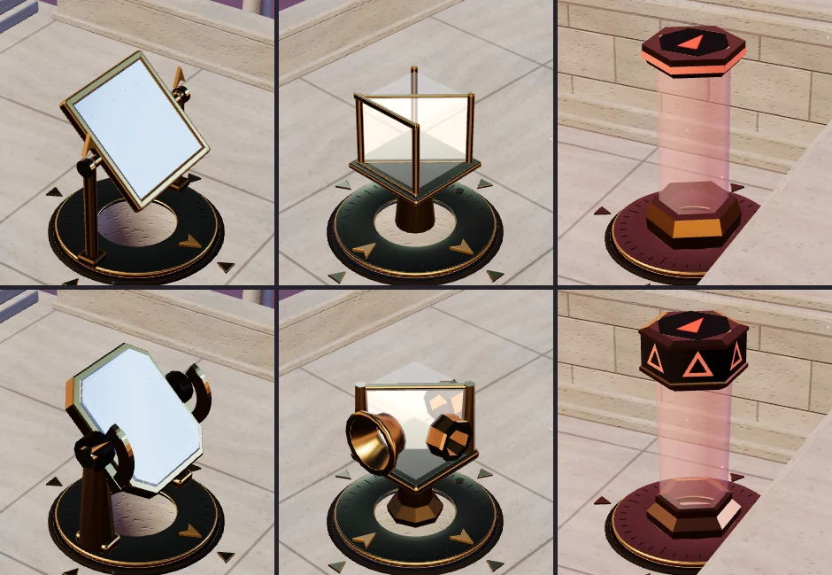
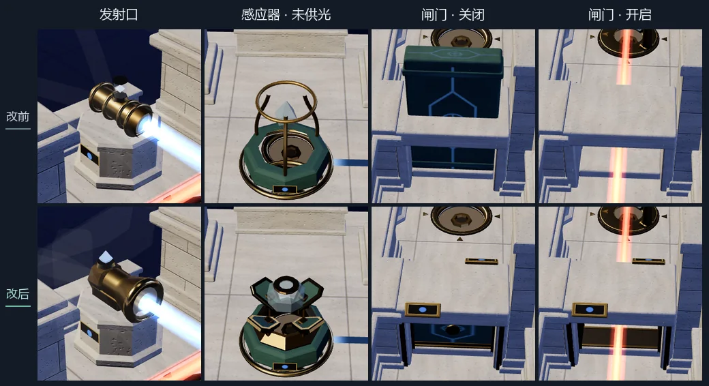

# 棱镜密室：玩家试玩与美术打磨清单

## 试玩基线

基线：`main@707472f`。使用离线 Chromium / SwiftShader，以 1280×800 键鼠和 390×844 触屏视口进入游戏。用托盘和鼠标完成首关、撤销、再解开；抽查第十关的三层构图。以下区分已复现缺陷与艺术方向，不把软件渲染器的帧率当作真机成绩。

值得保留：离线单文件、可撤销的无惩罚解谜、五章十室，以及用三角/方形/圆形区分通道。玩家需要看清**哪一束光、哪个槽、为什么没有接通**，而不是更多特效。

## 玩家任务表

| 优先级 / 编号 | 试玩发现 | 一项任务的验收条件 |
| --- | --- | --- |
| P0 · IN-01 弹窗输入隔离 | 首关放下镜子，打开「操作」，按 Ctrl+Z；帮助仍在，镜子却消失。Tab 焦点也留在底下的画布。 | 选关和帮助只接收自己的输入；Tab / Shift+Tab 不离开弹窗，Esc 关闭并恢复焦点；关窗后撤销仍可用。 |
| P1 · IN-02 双指误落子 | 拿起水平镜，一指按在槽位上不松，另一指按空处，再一起松手：没打算落子却多了一面镜；反过来按会取消手中的镜。拖动被系统中断后还显示抓取光标。 | 双指只缩放；不修改棋盘、手中元件、选择或撤销历史。引导 A 标记同样遵守；手势取消后能重新单指放镜、转镜。 |
| P1 · IN-03 连续取件 | 第七关刚放好红滤片，点绿滤片卡想取下一件，红片却被收回，还多出一步撤销。点两张卡之间也可能拆掉已选元件。 | 有库存的卡只负责取件，包括继续取同种元件；点空卡或卡间空隙保留棋盘；只有明确点「回收」才取下所选元件，且可一步撤销。中英文说明与实际触控一致。 |
| P1 · UI-01 窄屏布局 | 390px 宽时计分覆盖关名；第十关托盘从 x=-51 到 442，首张卡片和提示按钮被裁掉。菜单收起后依赖悬停。 | 两种语言在 390×844 和低高度横屏都可点选关、元件、提示、旋转与下一关，不遮盖关键槽位；1280px 不退化。 |
| P2 · UI-02 结算与教学重叠 | 首关解开后，中等宽度视口的最后一步教学被结算卡压住。点「留在本关」之后，教学还让玩家点已经收起的「下一关」。 | 中英文、横竖屏结算时只显示结算卡，不留透明挡区。「留在本关」恢复有效的提示，主动关闭的教学不复活；撤销、再解开和进入下一关都能用。 |
| P1 · UI-03 自由选关的结局 | 新存档先过第十关，结算却说十关全通，只有「留在本关」；反过来最后补过第一关时，又没有结局。 | 第十关先过时显示真实进度，一键进入首个未过关；不论顺序，补齐十关才显示结局。保留旧星级、普通下一关、重玩与中英文切换。 |
| P1 · EDU-01 第一面镜子 | 首屏提示只说「点光路上的槽位」，放好后只提示 R；窄屏玩家没有实体键盘，且第一个弯道部分藏在石柱后。 | 把教学拆成取镜、选槽、转镜、确认亮核；同时描述屏幕按钮与快捷键。真人无攻略完成；撤销后提示对应当前步骤。 |
| P1 · EDU-02 横屏的 A 槽 | 480×320 首关拿起水平镜后，提示让点 A，但操作栏盖在槽上，A 标记也消失了。中文与英文都能复现。 | 默认机位不拖动、不缩放：点托盘 → A → 旋转 → 下一关。320×280 的英文说明和操作栏不重叠；第七关四张卡都能取件。 |
| P1 · CAM-01 折射门的起始视线 | 第八关已选 L1，也能看到光束，但从默认角度点光束尽头的槽中心会打在廊柱上；中、上层各有一个同类死角。 | 不旋转、不缩放，仅选楼层即可点四个参考槽的中心并通关。镜头复位能回到此构图；不扩大拾取范围、不让点击穿墙。 |
| P1 · LOC-01 语言连续性 | 首页切换语言后，游戏仍独立按浏览器语言选默认值；中文界面的教学关闭按钮叫 `close`。 | 从首页进入对应语言，直接打开仍尊重游戏存档与浏览器；教学、无障碍名称、结算与帮助同语；切换语言不改动棋盘。 |
| P1 · PERF-01 帧预算可信度 | 第十关低画质报告 95 draws / 70,670 三角形，而首关高画质只报告 1 draw / 1 三角形：后处理统计只剩最后一通道。帧循环还把模拟步长当作 FPS 的采样间隔。 | 全帧含后处理统计；性能监测用真实前台帧间隔，不计失焦/隐藏停顿；模拟步长继续封顶；用慢帧、正常帧与手动画质覆盖做回归。 |
| P1 · PERF-02 提示与预览的 GPU 资源 | 首关每次显示再关闭提示模型，净增 24 个 WebGL 缓冲区；替换鼠标下的元件预览也只移除模型，未释放几何。 | 提示反复开关、光标下在镜片与滤片间切换后，同一可见状态的几何数不增长；切画质不能把幽灵预览换回实体玻璃。 |
| P1 · PERF-03 隐藏楼层的材质 | 第十关选 L1、上层淡出后换到首关，每轮多留三张纹理；在 L1 切高画质，上层玻璃提前出现，再选「全部」却仍用低档材质。 | 只在楼层展开时显示所选画质，保留淡淡的轮廓；离开关卡同时释放本关两档材质和自有纹理，不销毁共享资源。重复路径的原生纹理数不增长。 |
| P1 · PERF-04 切画质后的粉尘材质 | 首关从低档起在菜单循环切换 12 次，画面仍只有一组粉尘，但旧材质没有释放，粉尘的着色程序引用由 1 增至 13。 | 替换粉尘时释放它独占的材质；低档 150 粒、中高档 300 粒仍实际绘制。反复切换时不积累材质或着色程序引用。 |
| P1 · GFX-01 切章与画面恢复 | WebGL 上下文恢复后，核心与黄铜会变黑，但仍能通关；从另一章进入同一密室，部分槽位也会使用上一章的反射贴图。 | 不重载棋盘即可恢复原光照；换章、恢复画面、重新展开淡出的楼层时，反射器件都使用当前章节的环境。 |
| P2 · GFX-02 高档光晕 | 第六关上层升降镜受光时，高档近景中镜背和弯折的光束一起发白；同机位低档仍能看清。 | 以同机位高低档检查镜背、光束边缘和核心点亮的层次；未受光的镜片不能像另一粒亮核。保留通关反馈，并复测后处理成本。 |
| P2 · QA-01 平台与长玩 | 自动测试覆盖十关规则及首关基本操作，不等于十关真人可读或长时间稳定。 | 真机集显与触屏分别跑十关；采集预热后的帧时间 p50/p95、反复换关的 GPU 资源趋势，检查上下文恢复。记录设备和复现条件再设发布预算。 |
| P1 · QA-02 发布验证超时 | 在最近八次截至 `d9cac26` 的主线验证中，两次棱镜已通过，但全站检查随后用尽 20 分钟，没有发布。 | 完整棱镜回归与其余站点回归并行，不删断言、不放宽任务时限；任一路失败、取消或跳过，原有门槛都不能放行。PR 不部署。 |

## 3D 建模任务表

| 优先级 / 编号 | 资产与可读性问题 | 艺术方向与验收镜头 |
| --- | --- | --- |
| P1 · ART-01 接收核心 | 首关亮石材上的未点亮核心近似空托架；主要靠浮动标签找目标。 | 给晶体有明暗层次的内部切面和独特冠座。空暗、部分接通、匹配三态不依赖颜色或 bloom；首关低档、末关三层都能辨认，保留竖直入光的中孔。 |
| P1 · ART-02 黄铜槽与水平镜 | 远看槽像地洞，镜面和背面的细筋缩到一两个像素。 | 槽唇用连续明暗分界；镜背用大块结构筋、正面留干净反光。默认镜头和反向镜头能分辨正反，鼠标拾取和射线规则不变。 |
| P2 · ART-03 升降镜、棱镜与滤色片 | 方向箭头很小，更该靠轮廓读出元件功能。 | 升降镜突出俯仰铰链；分光器做出一入两出的端口；滤片带对应通道刻纹。检查第三关俯视/侧视与分色关低档。 |
| P2 · ART-04 发射器、感应器与闸门 | 第十关同屏有源、感应器和目标；远看都是小金色器件。 | 发射口、接收面、闸轨有不同轮廓；熄光仍看得懂闸门和对应感应器；不得挡住真实光路。 |
| P2 · ART-05 廊柱、楼板与远景 | 首关柱冠遮住后方槽，末关三层楼板边缘视觉权重相近；远景碎块会贴近棋盘轮廓。 | 从默认位和反面检视遮挡，区别实心楼板/天井边；用材质与大轮廓区分章节，而非堆微小装饰。改动前后对比 draw calls 和相同解法。 |

## 合并门槛

**QA-02**：主线运行 `44627270966` 和 `44638623080` 的棱镜步骤分别用时 7 分 29 秒、7 分 49 秒，均成功；下一项检查因整份任务超过 20 分钟被取消。现在棱镜在独立 runner 上构建并跑同一条 `npm run test:prism`，全站的其他测试、构建和发布包 dry-run 原样保留。`Validate site` 汇总两路实际结果，再与原有 Ace 检查共同把关。这里衡量的是验证与发布可靠性，不是游戏帧率。

**UI-03**：结算只认这十间密室实际获得的星级，不用关号或存档记录总数猜进度。用新存档从选关菜单先去第十关，在正常动画中用托盘放五件器材：现在得到「已解开 1 / 10 关」，按钮能回到第一关，第十关的三星还在。同一存档用参考解补齐第二至九关，再实点首关的 A 槽和旋转，才出现完整结局。之后重玩普通关仍可继续下一关，重玩第十关可重看结局。

下图是 390×844 中文 Chromium 模拟触屏的两次结算，不是真人盲玩。中英文另按一至十顺序，用参考解和结算按钮走完全程：每种语言前九次均能进下一关，仅第十次显示结局。回归也覆盖旧存档的一星/二星、零星记录、未知关卡 ID 与结算中切语言。

**CAM-01**：第八关原来的默认机位把三个参考槽的中心藏在柱后；能转动镜头绕开，但新玩家看到光束却未必知道为什么放不下。现在仅调整入场与复位共用的角度，不改镜距、拾取范围、遮挡规则或解法。390×844、320×568、480×320、844×390、1024×720，各测中英两语：只换楼层，不转动或缩放，四件器材点槽心落位由 **10/40 → 40/40**，按此操作通关由 **0/10 → 10/10**。正常动画从第七关选关进入，用 Chromium 触屏模拟与 Windows WebKit 鼠标均能在两种语言下进入第九关。测试用投影定位点击，不是真人盲玩。

下图是 390×844 中文第一件升降镜在手时的棋盘裁图，左原机位、右新机位。800×640 的同版对照：第八关高档空盘 **218 → 216** 次绘制、**206,678 → 206,662** 个三角形，低档空盘 **91 → 90**、**72,936 → 72,928**；第七、九关三档空盘和解开的 12 组绘制量均未变化。这是同场景取样，不是设备帧率。

**GFX-02**：收紧中、高档的光晕，让亮束和受光的镜背各自保留轮廓。没有改章节曝光、光源、低档直绘路径或核心点亮的规则。第六关相同升降镜近景（800×640 中取 330×340，RGB 最低通道 ≥220、通道差 <38 计为近白）：Chromium / SwiftShader 高档近白占比约 **66%→3%**，中档约 **66%→1%**，低档仍约 **0.6%**。这个机位高档仍是 **240 次绘制 / 130,110 个三角形**，不据此推算 FPS。

下图左改前、右改后；上排是第六关受光镜背，下排是第七关匹配核心。把新版本的同一帧与临时关闭光晕的帧对照：以任一颜色通道多出至少 16/255 为准，匹配核心局部仍有约 **26%** 的像素获得明显光晕，未接通时不到 **1%**。

**PERF-04**：首关低档开始，正常动画下用菜单按低→高→中→低循环四轮。改前只释放了 12 份旧几何，旧材质一次也没释放：粉尘关联的原生 WebGL 程序有 3 个，着色程序的使用引用合计 13。改后 12 份旧几何和材质都释放；每一步仅剩 1 个活跃程序和 1 份引用。仍可见低档 150 粒、中高档 300 粒粉尘。这是 Chromium / SwiftShader 的资源寿命验证，不是帧率提升量。

**EDU-02（UI-01 横屏复测）**：从默认镜头拿起水平镜，在 320×280 到 844×390 的十组横屏和两组竖屏分别试玩中英版。改前 **12/24** 组能直接点 A，改后 **24/24** 组能点 A 并旋转接通；同一批视口的第七关四张卡都能实际取出。480×320 的正常动画流程也用触屏模拟走到了第二关，没有调用测试 API 或移动相机。图中左为改前、右为改后：保留可点击的器材操作，把提示和托盘让出光束终点，而不是把 A 强行盖在按钮上。

**UI-02**：首关用托盘、A 槽标记和旋转按钮解开，等动画结束后量取两个面板的交集：768×600 英文是 **1,880**、中文是 **1,210** CSS 平方像素；720×540 分别是 **2,120** 和 **1,690**。现在结算卡出现时教学没有布局框，不会挡住棋盘标签。离线 Chromium 的 7 个视口 × 两种语言均为零重叠，两枚结算按钮均可点。「留在本关」后只提示仍可执行的撤销；也验证了主动关教学、撤销、再解开和进入第二关。

已验证的改进：**IN-01** 在 Chromium 离线回归中覆盖选关和帮助的焦点循环、Space/Esc 关闭、焦点归还，以及弹窗内 Ctrl/Cmd+Z 不改动棋盘。

**IN-02**：390×844、离线 Chromium，通过触摸事件按两种顺序同时触碰空处和首关中段槽。修复前分别误落子（历史 0→1）或丢掉手中镜；现在两种顺序的历史均为 0，镜子仍在手中。双指拉开使两个固定槽的屏幕间距由约 70px 增到 105px，反向收拢恢复原视角。引导 A 标记、已有选择、系统取消和指针捕获丢失也有回归；释放后单指仍能正常放镜。这是触屏模拟，不是实体设备测试。

**IN-03**：第七关放红滤片后点绿滤片卡，原先红片被收回（棋盘 1→0、撤销历史 1→2），绿片也没拿到。现在红片保留，绿片在手，历史仍为一步；明确回收后一次撤销即可还原。用已知参考路线，以 1024×720 英文鼠标和 390×844 中文模拟触屏分别跑完十关：每次实际放置 32 件，无须先按「取消」（旧路线每次有 22 次主动取消）。回放通过托盘、槽位点击、旋转、翻转和换层按钮操作，使用投影位置定位并推进模拟时间，不是无攻略真人首通。

**UI-01**：在 390×844、844×390 的两种语言下，标题可点击展开菜单，动作和元件不再挤出屏幕。第十关竖屏托盘边界由 `[-51, 442]` 变为 `[8, 382]`；320px 宽的第七关也能同时放下四张元件卡。使用 Chromium 触屏输入实际完成首关放镜、转镜、下一关和选关，并检查关卡十的按钮中心没有被覆盖。这是触屏模拟，不是实体手机性能认证。

**PERF-02**：首关低档 1024×720，预热后等长重复六轮提示显示/关闭，拦截 WebGL `createBuffer` / `deleteBuffer` 计数。修复前 198→342，修复后七个采样点均为 198。另有第七关滤片提示、鼠标预览替换的常驻几何数回归；这只证明该条路径不再累积，不代表整场游戏零泄漏。

**PERF-03**：离线 Chromium / SwiftShader、640×440。先切换画质预热，再在第十关低档选 L1，等上层淡出后回到首关。以 WebGL `createTexture` / `deleteTexture` 配对计数：原先六次返回分别为 **41、44、47、50、53、56**，修复后六次均为 **35**。先选 L1 再切高档的六个玻璃网格都保持淡出，展开后才使用高档材质；未接通的核心也不再把整层轮廓透明度写成零。离开时观察到的四个关卡私有玻璃材质各释放一次，共享光晕纹理没有被释放。此结果只覆盖这条路径，不是显存字节数或真机帧率。

**PERF-01**：`PRISM.state().fps` 统计前台显示帧数 / 实际经过时间；没有样本时为 0。模拟每步仍封顶 50 ms，`PRISM.step()` 或 `info()` 不会伪造显示帧。离线 Chromium 输入 250 ms 帧间隔：旧版 30 帧后报告 29 FPS，新版报告 4；一秒内混合 10 个快慢帧报告 10。失焦/隐藏与恢复的间隔不参与降档，持续慢帧会下调自动画质，不改玩家手动选择。

第十关 480×320、默认机位、空棋盘：拦截 WebGL 绘制调用，与 `PRISM.info()` 同帧对照。低档均为 **96 次 / 67,106 三角形**；中、高档旧统计只剩 **1 / 1**，修复后均为 **225 / 180,980**，含阴影和后处理。两档几何提交量相同不等于帧时间相同。这是计量修复，不是声称 GPU 变快或真机达到 60 FPS。

**GFX-01**：离线 Chromium / SwiftShader、640×440，同一冻结画面只触发 WebGL 上下文丢失和恢复。首关低档原有 23.2% 像素至少一个 RGB 通道变化超过 12/255，第七关高档为 7.0%；重建反射贴图后，两处逐通道读回均与恢复前一致。首关保留已放置和选中的镜，旋转即可通关。另直接核对 GPU 绘制时的采样器：跨章进第七、九关时原先同时用了两张环境图，现在只用本章的一张。不以软件渲染替代实体设备验收。

**EDU-01**：旧版把镜子放在中段槽后，两种语言仍提示转镜；取消选择和关闭提示也没有得到尊重。现在首关按取镜、放置、转镜、亮核四步提示，目标槽的 A 标记随镜头移动，也可直接点按。放错会引导移动，取消选择会提示重新选中；撤销会回到对应步骤，关闭后本关不再弹出。离线 Chromium 已验证中英文、键鼠和模拟触屏；真人首次无攻略通关仍待观察。

**LOC-01**：首页卡片的图片和「开始游戏」都使用当前界面语言。直接进入时，受支持的 `?lang=zh` / `?lang=en`（含地区变体）优先于游戏内保存的偏好，再回退到浏览器；无法匹配时用英文。游戏内切换只更新界面、语言偏好和地址参数，不动关卡、棋盘、撤销历史或星级，刷新也不会被旧链接的语言覆盖。已验证 20 种首页视口、两处真实入口、离线直达、双语引导/帮助/结算和无障碍按钮名称。

**ART-01**：接收核心改为错层切面的外晶、深色内芯和带刻度的四爪冠座。收到部分通道时晶体上浮、表盘部分亮起，精确匹配才闭环；天井处底座仍是通孔。第七关同机位低档实机图，从左至右是未接通、只收到红光、红绿匹配；没有启用 bloom。1280×800 默认视角低档：首关 56→56 draws、28,690→25,042 三角形；第十关 95→96 draws、70,670→67,106 三角形。这是提交给 GPU 的几何量，不是 FPS 提升率。

**ART-02**：黄铜槽用暗色外肩和抛光内斜口区分槽与地面，实心槽里有八角定位孔，楼板天井不封底。水平镜正面是切角镀银镜片，背面是两条宽筋和六角轴头；两侧叉架止于枢轴，不再伸过镜框。第二关同机位低档实机裁图：上排改前，下排改后；从左到右为空槽、无光镜面、镜背。另在首关高低档检查受光转角，在第六关从上层天井看下层光路。

1024×720、低档默认机位、相同参考解：首关解开前后版本均为 63 次绘制，三角形由 31,358 降至 26,518；第十关解开均为 151 次绘制，三角形由 97,800 降至 87,288。未调整鼠标拾取、镜面朝向或解谜规则；几何减少不是实测帧率提升。

**ART-03**：升降镜有两侧开口的俯仰刻度盘；指针和镜片共用转轴，翻转时可直接看出向上还是向下。分光器用一个喇叭口收光、两个八角短口出光，三个孔都以光束中心为轴。滤片帽的六面都有通道嵌纹：红三角、绿方框、蓝圆环；不必俯视顶标。下图为同机位、未接通、无 bloom 的游戏实拍：上排改前，下排改后（第五关升降镜、分光器；第七关红滤片）。

离线 Chromium / SwiftShader：第三关侧拍、俯拍、翻回原位后能接通上层核心；第五关在槽上转一整圈，只有入口对准来光时才点亮直路核心。1024×720 低档、相同参考解：第三关 **69→67** 次绘制、**46,416→42,628** 三角形；第五关 **105→101**、**64,602→55,326**；第十关 **151→147**、**87,288→78,012**。第七关的滤片嵌纹使三角形 **38,430→38,634**，绘制仍为 **102**；水平镜首关仍为 **63 / 26,518**。没有增加每帧动画，也没有据此推算真机 FPS。器材建模时发现的高档光晕遮形问题，后续修复见 GFX-02。

**ART-04**：发射器用收窄后张开的黄铜灯口表示方向，玻璃表面与原光束起点的距离由 0.085 缩至 0.032 个场景单位。感应器改为四瓣接光面，供光时升起；以前从 +Z 来光会先撞上笼架模型，现在四个水平方向最先碰到的都是光学玻璃，第九关的上下入光口也通畅。闸轨装在原石框上，门楣边沿的通道徽记与感应器底座对应；不改变解谜、遮挡或发光通道规则。

第九、十关的露天门框都高 1.60，旧闸板却升到了 2.86。现在闭合时上缘为 1.296，正反两面的挡光面仍在光路中心线两侧 0.21；打开后上缘落至地面以下 0.09，不再绘制藏在楼板下的门体。第九关验证竖直供光、开闸、撤销后重闭；第十关正常动画里先打断水平蓝光再撤销，闸门开启→关闭→重开。Chromium 模拟触屏和 Windows WebKit 鼠标均走通中英版，不是真机测评。

离线 Chromium / SwiftShader，800×640、十关 × 三档 × 空盘/参考解，**60/60** 组接通数一致，各组少提交 **2,360–25,052** 个三角形。第九关高档空盘是取舍：**187→189** 次绘制，三角形 **150,492→133,476**；解开后 **281→277**、**178,842→160,758**。同关低档空盘仍为 **84** 次，解开后 **124→122**。不据此推算设备帧率。

每项从当时的 `origin/main` 建独立 worktree 和分支，PR 只做该项，目标为 `main`。规则或交互改动跑 `node scripts/build-site.mjs` 与 `npm run test:prism`；界面/资产改动看实机渲染截图，性能结论写明档位、场景和采样方式。代码 PR 等仓库检查通过再合并；仓库现有工作流会自行处理 main 上的发布，不另行手动部署。不能用一次绿灯证明「零 bug」或「AAA」。
