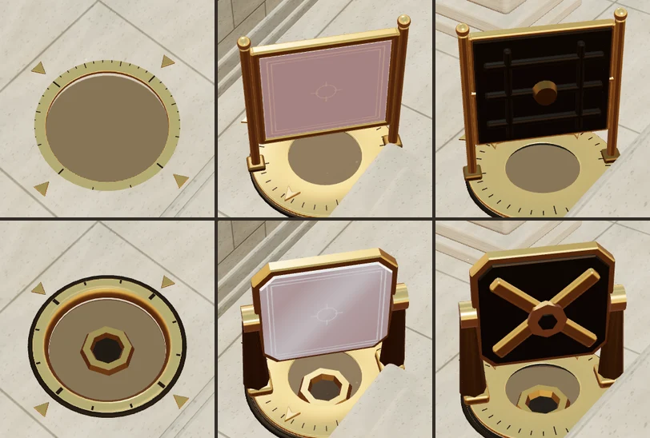

# 棱镜密室：玩家试玩与美术打磨清单

## 试玩基线

基线：`main@707472f`。使用离线 Chromium / SwiftShader，以 1280×800 键鼠和 390×844 触屏视口进入游戏。用托盘和鼠标完成首关、撤销、再解开；抽查第十关的三层构图。以下区分已复现缺陷与艺术方向，不把软件渲染器的帧率当作真机成绩。

值得保留：离线单文件、可撤销的无惩罚解谜、五章十室，以及用三角/方形/圆形区分通道。玩家需要看清**哪一束光、哪个槽、为什么没有接通**，而不是更多特效。

## 玩家任务表

| 优先级 / 编号 | 试玩发现 | 一项任务的验收条件 |
| --- | --- | --- |
| P0 · IN-01 弹窗输入隔离 | 首关放下镜子，打开「操作」，按 Ctrl+Z；帮助仍在，镜子却消失。Tab 焦点也留在底下的画布。 | 选关和帮助只接收自己的输入；Tab / Shift+Tab 不离开弹窗，Esc 关闭并恢复焦点；关窗后撤销仍可用。 |
| P1 · UI-01 窄屏布局 | 390px 宽时计分覆盖关名；第十关托盘从 x=-51 到 442，首张卡片和提示按钮被裁掉。菜单收起后依赖悬停。 | 两种语言在 390×844 和低高度横屏都可点选关、元件、提示、旋转与下一关，不遮盖关键槽位；1280px 不退化。 |
| P1 · EDU-01 第一面镜子 | 首屏提示只说「点光路上的槽位」，放好后只提示 R；窄屏玩家没有实体键盘，且第一个弯道部分藏在石柱后。 | 把教学拆成取镜、选槽、转镜、确认亮核；同时描述屏幕按钮与快捷键。真人无攻略完成；撤销后提示对应当前步骤。 |
| P1 · LOC-01 语言连续性 | 首页切换语言后，游戏仍独立按浏览器语言选默认值；中文界面的教学关闭按钮叫 `close`。 | 从首页进入对应语言，直接打开仍尊重游戏存档与浏览器；教学、无障碍名称、结算与帮助同语；切换语言不改动棋盘。 |
| P1 · PERF-01 帧预算可信度 | 第十关低画质报告 95 draws / 70,670 三角形，而首关高画质只报告 1 draw / 1 三角形：后处理统计只剩最后一通道。帧循环还把模拟步长当作 FPS 的采样间隔。 | 全帧含后处理统计；性能监测用真实前台帧间隔，不计失焦/隐藏停顿；模拟步长继续封顶；用慢帧、正常帧与手动画质覆盖做回归。 |
| P1 · PERF-02 提示与预览的 GPU 资源 | 首关每次显示再关闭提示模型，净增 24 个 WebGL 缓冲区；替换鼠标下的元件预览也只移除模型，未释放几何。 | 提示反复开关、光标下在镜片与滤片间切换后，同一可见状态的几何数不增长；切画质不能把幽灵预览换回实体玻璃。 |
| P2 · QA-01 平台与长玩 | 自动测试覆盖十关规则及首关基本操作，不等于十关真人可读或长时间稳定。 | 真机集显与触屏分别跑十关；采集预热后的帧时间 p50/p95、反复换关的 GPU 资源趋势，检查上下文恢复。记录设备和复现条件再设发布预算。 |

## 3D 建模任务表

| 优先级 / 编号 | 资产与可读性问题 | 艺术方向与验收镜头 |
| --- | --- | --- |
| P1 · ART-01 接收核心 | 首关亮石材上的未点亮核心近似空托架；主要靠浮动标签找目标。 | 给晶体有明暗层次的内部切面和独特冠座。空暗、部分接通、匹配三态不依赖颜色或 bloom；首关低档、末关三层都能辨认，保留竖直入光的中孔。 |
| P1 · ART-02 黄铜槽与水平镜 | 远看槽像地洞，镜面和背面的细筋缩到一两个像素。 | 槽唇用连续明暗分界；镜背用大块结构筋、正面留干净反光。默认镜头和反向镜头能分辨正反，鼠标拾取和射线规则不变。 |
| P2 · ART-03 升降镜、棱镜与滤色片 | 方向箭头很小，更该靠轮廓读出元件功能。 | 升降镜突出俯仰铰链；分光器做出一入两出的端口；滤片带对应通道刻纹。检查第三关俯视/侧视与分色关低档。 |
| P2 · ART-04 发射器、感应器与闸门 | 第十关同屏有源、感应器和目标；远看都是小金色器件。 | 发射口、接收面、闸轨有不同轮廓；熄光仍看得懂闸门和对应感应器；不得挡住真实光路。 |
| P2 · ART-05 廊柱、楼板与远景 | 首关柱冠遮住后方槽，末关三层楼板边缘视觉权重相近；远景碎块会贴近棋盘轮廓。 | 从默认位和反面检视遮挡，区别实心楼板/天井边；用材质与大轮廓区分章节，而非堆微小装饰。改动前后对比 draw calls 和相同解法。 |

## 合并门槛

已验证的改进：**IN-01** 在 Chromium 离线回归中覆盖选关和帮助的焦点循环、Space/Esc 关闭、焦点归还，以及弹窗内 Ctrl/Cmd+Z 不改动棋盘。

**UI-01**：在 390×844、844×390 的两种语言下，标题可点击展开菜单，动作和元件不再挤出屏幕。第十关竖屏托盘边界由 `[-51, 442]` 变为 `[8, 382]`；320px 宽的第七关也能同时放下四张元件卡。使用 Chromium 触屏输入实际完成首关放镜、转镜、下一关和选关，并检查关卡十的按钮中心没有被覆盖。这是触屏模拟，不是实体手机性能认证。

**PERF-02**：首关低档 1024×720，预热后等长重复六轮提示显示/关闭，拦截 WebGL `createBuffer` / `deleteBuffer` 计数。修复前 198→342，修复后七个采样点均为 198。另有第七关滤片提示、鼠标预览替换的常驻几何数回归；这只证明该条路径不再累积，不代表整场游戏零泄漏。

**PERF-01**：`PRISM.state().fps` 统计前台显示帧数 / 实际经过时间；没有样本时为 0。模拟每步仍封顶 50 ms，`PRISM.step()` 或 `info()` 不会伪造显示帧。离线 Chromium 输入 250 ms 帧间隔：旧版 30 帧后报告 29 FPS，新版报告 4；一秒内混合 10 个快慢帧报告 10。失焦/隐藏与恢复的间隔不参与降档，持续慢帧会下调自动画质，不改玩家手动选择。

第十关 480×320、默认机位、空棋盘：拦截 WebGL 绘制调用，与 `PRISM.info()` 同帧对照。低档均为 **96 次 / 67,106 三角形**；中、高档旧统计只剩 **1 / 1**，修复后均为 **225 / 180,980**，含阴影和后处理。两档几何提交量相同不等于帧时间相同。这是计量修复，不是声称 GPU 变快或真机达到 60 FPS。

**EDU-01**：旧版把镜子放在中段槽后，两种语言仍提示转镜；取消选择和关闭提示也没有得到尊重。现在首关按取镜、放置、转镜、亮核四步提示，目标槽的 A 标记随镜头移动，也可直接点按。放错会引导移动，取消选择会提示重新选中；撤销会回到对应步骤，关闭后本关不再弹出。离线 Chromium 已验证中英文、键鼠和模拟触屏；真人首次无攻略通关仍待观察。

**LOC-01**：首页卡片的图片和「开始游戏」都使用当前界面语言。直接进入时，受支持的 `?lang=zh` / `?lang=en`（含地区变体）优先于游戏内保存的偏好，再回退到浏览器；无法匹配时用英文。游戏内切换只更新界面、语言偏好和地址参数，不动关卡、棋盘、撤销历史或星级，刷新也不会被旧链接的语言覆盖。已验证 20 种首页视口、两处真实入口、离线直达、双语引导/帮助/结算和无障碍按钮名称。

**ART-01**：接收核心改为错层切面的外晶、深色内芯和带刻度的四爪冠座。收到部分通道时晶体上浮、表盘部分亮起，精确匹配才闭环；天井处底座仍是通孔。第七关同机位低档实机图，从左至右是未接通、只收到红光、红绿匹配；没有启用 bloom。1280×800 默认视角低档：首关 56→56 draws、28,690→25,042 三角形；第十关 95→96 draws、70,670→67,106 三角形。这是提交给 GPU 的几何量，不是 FPS 提升率。

**ART-02**：黄铜槽用暗色外肩和抛光内斜口区分槽与地面，实心槽里有八角定位孔，楼板天井不封底。水平镜正面是切角镀银镜片，背面是两条宽筋和六角轴头；两侧叉架止于枢轴，不再伸过镜框。第二关同机位低档实机裁图：上排改前，下排改后；从左到右为空槽、无光镜面、镜背。另在首关高低档检查受光转角，在第六关从上层天井看下层光路。

1024×720、低档默认机位、相同参考解：首关解开前后版本均为 63 次绘制，三角形由 31,358 降至 26,518；第十关解开均为 151 次绘制，三角形由 97,800 降至 87,288。未调整鼠标拾取、镜面朝向或解谜规则；几何减少不是实测帧率提升。

每项从当时的 `origin/main` 建独立 worktree 和分支，PR 只做该项，目标为 `main`。规则或交互改动跑 `node scripts/build-site.mjs` 与 `npm run test:prism`；界面/资产改动看实机渲染截图，性能结论写明档位、场景和采样方式。代码 PR 等仓库检查通过再合并；仓库现有工作流会自行处理 main 上的发布，不另行手动部署。不能用一次绿灯证明「零 bug」或「AAA」。
