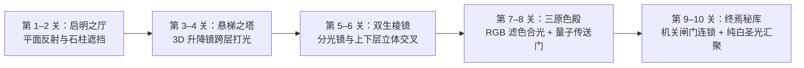

# Prism Vault · 棱镜密室 — 3D 立体光学空间解谜设计与实施方案

> 设计目标：转动石殿时，原本看似相交的两束光露出一层楼的高差，玩家由此找到解法。计划把 Three.js、程序化建筑与元件、光路规则、十关数据、中英 HUD 和 Web Audio 全部内置于 `games/prism.html`，不依赖外部模型、音频或贴图。

---

## 1. 产品定位与核心指标

| 项目 | 规格说明 |
| --- | --- |
| **游戏名称** | **PRISM VAULT · 棱镜密室** |
| **文件路径** | `games/prism.html`（单文件自包含） |
| **核心体验** | 纪念碑谷式极简建筑美学 × 真实 3D 立体光学空间解谜：360° 自由审视多层悬浮石殿，运用反射镜、立体升降镜、分光棱镜与 RGB 混色引导光束激活圣库核心 |
| **目标平台** | 纯桌面端键鼠优先（惯性阻尼轨道视角、精准 3D 格子拾取与高度对齐辅助线、快捷键零延迟布镜与旋转） |
| **单局时长** | 十关净解谜目标 **8–12 分钟**（§5 首轮配时合计 11 分钟，不是实测成绩）；支持任意选关、少用元件刷三星，不限时。 |
| **世界尺度规范** | 统一采用真实建筑网格尺度：`1 格 = 2.0 m × 2.0 m`，每层楼高 `4.0 m`（2 格），密室主体约 `14 m × 12 m × 14 m` |
| **语言支持** | 中文 / English 实时切换，与合集首页风格一致 |

### 1.1 从光束停下的地方读题

第一关只给一面水平镜：发射器指着墙，暗着的核心在拐角。沿光找槽位、放镜、转一格，墙上的光斑移到核心，外圈闭合才算解开。没有死亡或耗材；走不通时给**局部原因**（镜背吸收、石柱挡光、核心缺哪一色），而不是只弹「错误」。第三关把这个习惯带到两层石殿，剖面见 §5.1。

正常游玩只常显「已亮核心 / 总数」、元件托盘和楼层选择。选定一层后，上层遮挡物淡出、其他层槽位不可拾取；这是观察辅助，不会拆掉挡光的楼板。所有核心同时显示需要与已收到的通道：红 `R△`、绿 `G□`、蓝 `B○`，不靠区分红绿或听和弦才能解题。

---

## 2. 精细化 3D 场景构建拆分（分层模块化架构）

为了让极简解谜空间呈现高级博物馆/纪念碑谷般的雕塑立体感，整个 3D 密室拆分为 **5 大场景构建层级**：

### 2.1 第一层：静谧天穹与空间纵深（Ambient Void）
- **渐进色温天穹（Gradient Vault Sky）**：自定义 GLSL 垂直渐变背景穹顶，随章节推进呈现 5 种高级美术氛围（晨曦象牙金 → 碧海浅青 → 暮色黛蓝 → 琥珀紫罗兰 → 终焉深邃星穹）。
- **悬浮远景方尖碑与丁达尔微尘**：密室外围 `35 m – 80 m` 散布 12–16 座极简悬浮石碑与环状石环，缓慢自转营造宏大尺度感；密室内部漂浮 300 颗缓慢布朗运动的金色微尘粒子（`Points` + 自定义柔光圆点着色器），当激光穿过区域时增强空气通透感。

### 2.2 第二层：多层极简建筑主体（Architectural Structure）
- **模块化石材体块**：所有地面平台、阶梯、悬挑廊桥与厚重方柱均采用**精细倒角边缘（Beveled Edges）**与多层装饰线脚（Molding），绝不使用生硬直角的原始 `BoxGeometry`；边缘倒角能精准捕捉天光与激光高光，是极简建筑显高级的核心秘诀。
- **镂空天井、拱门与垂直连通空间**：二层/三层地板特意留出几何天井与半圆石拱门，让玩家在旋转 360° 视角时，能直观看到激光束穿透上下楼层、掠过石柱阴影的惊艳立体构图。
- **精密黄铜嵌槽（Socket Slots）**：每个可放置光学元件的格点都雕刻有下沉式圆环石座 + 抛光黄铜刻度环 + 4 个主方向微雕指针，悬停时亮起柔和金光并投射垂直高度对齐虚线，彻底消除 3D 空间中的高度错觉。

### 2.3 第三层：光源发射器与目标接收核心（Emitters & Receivers）
- **激光发射圣柱（Beam Emitter）**：八角石基座 + 精密黄铜聚焦透镜组 + 内部脉动单色晶体，透镜前端带有微弱散射光晕。
- **目标接收核心（Vault Core）**：悬浮于黄铜四爪托架中的多面体水晶（八面体/十二面体），未激活时为半透明冷灰色，带外圈目标色温提示环（如黄色提示环代表需要红+绿合光）；被正确颜色光束击中后，水晶加速自转、内部由暗转明并伴随充能进度光环闭合。

### 2.4 第四层：六类高精度光学机械元件（Optical Instruments）
每件元件均按真实精密光学仪器比例拆分建模（底座 + 旋转阻尼转盘 + 黄铜支架 + 光学玻璃/水晶主体）：
- **水平反射镜 (Flat Mirror)**：厚重黄铜框架镶嵌高反射镀银玻璃（`metalness = 0.96, roughness = 0.04`），背面有加固肋板防止玩家误判正反面。
- **立体升降镜 (Elevation Mirror)**：45° 倾斜镜架用箭头标明反射的两个端口；`R` 转底座、`F` 翻转镜架的上/下倾角。亮面导光、带肋的背面挡光。
- **分光棱镜 (Beam Splitter)**：正三棱/菱形高透光物理水晶（`transmission = 0.92, ior = 1.52, thickness = 0.8`），内部可见折射光斑。
- **滤色晶体 (Chromatic Filter)**：染色光学玻璃柱，附带顶部色彩标识环。
- **光桥传送门 (Quantum Portal)**：成对双环黄铜符文拱门，内部填充流动扭曲的彩色能量薄膜着色器，配对门用相同几何符号与边色标识。
- **遮光升降闸门 (Optical Gate)**：刻有导光凹槽的厚重深青石墙，充能解锁后伴随机械阻尼平滑沉入地板。

### 2.5 第五层：实体发光光束与光学接触特效（Volumetric Beams & Caustics）
- **三层复合激光束**：每段光束由「纯白高亮度核心柱（直径 `0.06 m`）+ 饱和彩色内辉光套管（直径 `0.16 m`）+ 外层 Additive 柔和光晕（直径 `0.32 m`）」构成，确保任何视角下都清晰锐利且富有光学厚度。
- **镜面反射光斑与合光反馈**：镜面和棱镜的入射点有光斑，核心收齐所需通道才出现波纹；两束光只是在画面上交叉时不发出提示。

---

## 3. 真实光影、PBR 光学材质与视觉层次管线

| 渲染环节 | 具体实现参数与技术选型 |
| --- | --- |
| **建筑级自然光与软阴影** | 主暖阳方向光 `DirectionalLight`（`#fff5e4`, 强度 `2.1`）以 `42°` 黄金建筑摄影斜角照射，`2048×2048` `PCFSoftShadowMap` 紧贴 `±14 m` 密室范围，产生极其锐利干净的建筑几何投影；辅以冷青色背光补光（Rim Light）勾勒石柱暗面轮廓。 |
| **环境反射与玻璃折射** | 用程序化环境贴图给镜面和黄铜描边，不让玩家靠辨认镜中建筑来解题。High 的水晶用透射材质；Med 减少染光点，Low 关闭透射、动态阴影与 Bloom，保留亮面刻线、光束实芯和命中光斑。 |
| **程序化微颗粒石材纹理** | 离屏 Canvas 生成 512×512 细腻洞石/大理石纹理（含微孔粗糙度变化与微妙色阶过渡，`roughness: 0.78–0.88`），与高光滑黄铜/水晶形成极佳的“哑光 vs 镜面”材质对比。 |
| **光束实时环境染光** | 在关键光束反射点与已点亮的核心处挂载轻量化动态 `PointLight`（随光束颜色实时变色），让红、绿、蓝、白光束真实地将周围的象牙白石柱与地板染上对应的柔和彩光，大幅提升立体真实感！ |
| **色调映射与精致辉光** | `ACESFilmicToneMapping` + 高阈值柔和 `UnrealBloomPass`（`threshold = 0.86, strength = 0.50, radius = 0.45`），让激光束呈现电影级光学通透感而不刺眼。 |

---

## 4. 光路判定与镜架动画

关卡是六个轴向的离散光路，不是任意角度的折射模拟。坐标按 `(x,y,z)` 书写，三轴每步 `2 m`，`+Y` 向上，三层槽位的 `y` 分别为 `0/2/4`。相机、材质和粒子不参与判题。

1. **三维镜面反射定律（Law of Reflection）**：
   - 给定归一化入射光方向向量 $\vec{d}$ 与镜面法线 $\vec{n}$（如 45° 水平镜 $\vec{n} = (\pm\frac{\sqrt{2}}{2}, 0, \pm\frac{\sqrt{2}}{2})$，45° 立体升降镜 $\vec{n} = (\pm\frac{\sqrt{2}}{2}, \pm\frac{\sqrt{2}}{2}, 0)$ 等），严格按向量反射公式求解出射方向：
     $$\vec{r} = \vec{d} - 2(\vec{d} \cdot \vec{n})\vec{n}$$
   - 背面遮挡严格判定：若 $\vec{d} \cdot \vec{n} \ge 0$（光束击中镜背金属板），则吸收阻断而不穿透，符合真实镜面物理。
2. **用三个通道判色，不用屏幕像素判色**：红、绿、蓝分别记作 `1/2/4`。滤色只保留交集，为零即止；分光从标记入口接收，沿直线与侧箭头输出同色两束，各取一半光强。光强只改表现，不设挡住正确解的隐形亮度门槛。
   - 光在空格交叉（即便同层）时各走各的；只有到达**同一接收核心**才把通道取并集。目标要求精确相等：黄芯收红和绿会亮，再多蓝就显示「多蓝」。所有目标在同一次完整求解中匹配才结算，先前亮过的不算。
   - 传送门和闸门是固定设施，不占托盘。光从配对门的标记入口进入，保色保强，从出口箭头外一格继续，不在出口原地触发回传。石柱、闭闸、镜背均截断；开放闸道只允许光直行，不改色。
3. **菲涅尔与斯涅尔折射视觉建模（Snell's Law & Fresnel）**：
   - 分光棱镜与核心水晶采用物理 `ior = 1.52–1.65`（冕牌玻璃/水晶折射率），根据观察角自动计算菲涅尔高光反射率 $R(\theta) = R_0 + (1 - R_0)(1 - \cos\theta)^5$，旋转视角时水晶切面闪烁真实光泽。
4. **循环和闸门**：每次正式编辑后从全闭的闸门开始。固定闸态下，从所有光源追踪，先处理最亮分支；同一 `(格点, 入射方向, 通道掩码)` 只展开一次。这样镜环会停止，不会吞掉同格不同颜色的有效来光。每批可处理 32 个状态，剩余队列接着算，不能把第 33 段当作无光。
   - 机关接收器只检查「包含所需通道」，与精确配色的终点不同。本轮新通电的闸门一起打开，清空访问记录再追踪；本次求解闸门只开不关，最多「闸门数 + 1」轮。只发布最终结果；期间若再次编辑则放弃旧结果。移走供光镜后从全闭重算，未获得供光的闸门会重新挡住光束。
5. **临界阻尼机械运动学（Critically Damped Springs）**：
   - 玩家按 `R` 旋转镜面 90°、元件落入石槽、遮光闸门液压升降以及轨道摄像机旋转，均由二阶临界阻尼弹簧方程 $\ddot{\theta} + 2\omega_n\dot{\theta} + \omega_n^2(\theta - \theta_{\text{target}}) = 0$（$\omega_n \approx 18\text{ rad/s}$）驱动，带来沉稳、精准、毫无晃动过冲的精密仪器手感。

---

## 5. 十关递进式战役设计



| 关卡 | 名称 | 核心机制与空间构图亮点 | 预计用时 |
| --- | --- | --- | --- |
| **01** | 初光 · First Light | 单层雅致回廊，熟悉旋转视角、放置与 90° 旋转水平镜 | 30s |
| **02** | 柱廊 · Colonnade | 3 面反射镜绕过实体石柱；地面上的柱影不是障碍 | 40s |
| **03** | 跃层 · Ascent | 只给一面升降镜，找出楼板真正开孔的位置 | 45s |
| **04** | 双塔 · Twin Spires | 上下两层折返反射，沿水平方向穿过拱门再向下导光 | 55s |
| **05** | 分流 · Bifurcation | 引入分光棱镜，一束蓝光分流，同时点亮高低两座核心 | 60s |
| **06** | 交叉回廊 · Crossfire | 俯视时两个光斑重合；转动石殿会发现一条光路从另一条上方经过 | 65s |
| **07** | 光谱 · Spectrum | 引入 RGB 滤色，让红、绿两路在黄芯而不是在走廊相交 | 70s |
| **08** | 折射门 · Quantum Arch | 利用配对门的出口朝向，将光送入密闭顶层石室 | 75s |
| **09** | 连锁密室 · Resonance | 分流蓝光给机关持续供光，让红光穿过开启的石闸 | 95s |
| **10** | 棱镜圣殿 · The Vault | 三层石殿中分别送达 RGB 三路，同时汇入白芯 | 125s |

### 5.1 可手推的第 03 关：一面镜，两处槽

以下是固定 `z=1` 的剖面，横向为 `+X`，上方为 `+Y`。`S` 发出红光，`C` 从底面收红；托盘只有一面升降镜。空槽本身不挡光。

```text
y=2 (L2)    .       .       C
y=1         .       #       ↑
y=0 (L1)    S ----> B ----> A
           x=0     x=1     x=2
```

把镜放在 `B=(1,0,1)` 并朝上，光斑打在楼板 `#=(1,1,1)`，核心仍暗。把同一面镜移到 `A=(2,0,1)`，亮面将 `+X` 转为 `+Y`，光经天井 `(2,1,1)` 抵达 `C=(2,2,1)`；用量为 1，空盘面不可能通关。两种布局从正上方看很像，旋至侧面即可解释差别，不必猜隐藏高度。

**撤销与星级**：每次确认放置、移动、旋转、翻面、回收或重置算一步；`Z` 原子撤销这一步并重算（移动不会先吞掉原件）。转镜头、悬停和看提示均不入栈。`H` 先指出关键槽，第二次才给元件与朝向，不扣星。通关 1 星；最终摆放数不超过关卡参考用量 +1 得 2 星，不超过参考用量得 3 星，固定设施不计。过关后不自动跳页，仍可撤销尝试更省的解；选关保留最高星，不继承盘面历史。

---

## 6. 桌面端键鼠操控与 Web Audio 音效

| 操作 | 键位 | 效果说明 |
| --- | --- | --- |
| **360° 审视密室** | 单指拖动、右键拖拽或 `WASD` | 环绕观察上下楼层；拖动结束不落子。 |
| **缩放视角 / 复位** | 双指开合或鼠标滚轮 / `Space` | 双指拉开以拉近，合拢以拉远；两指都抬起前不会把缩放误判成落子。`Space` 恢复初始视角。 |
| **放置 / 移动 / 回收** | `左键` 选元件，再点目标槽或托盘 | 悬停只给对齐线；选另一空槽可直接移动，选托盘回收。目标无效或按 `Esc` 取消，原件留在原位。 |
| **旋转 / 翻面** | `R` / `F` 或对应按钮 | `R` 水平步进 90°，`F` 仅翻升降镜。选中元件时滚轮也只缩放；提交新朝向才判题，转动动画中途不触发过关。 |
| **快捷切换元件** | `1` / `2` / `3` / `4` | 快速选用水平镜、升降镜、分光棱镜、滤色晶体 |
| **撤销 / 重置 / 提示** | `Z` / `Backspace` / `H` | 流畅试错，零弹窗打断 |

- **Web Audio 空灵音效引擎**：元件落槽的温润石材轻叩、黄铜转盘的精密机械棘轮声、光束命中不同核心时触发的**五声音阶竖琴/水晶玻璃琴和弦**（点亮核心越多，和弦越丰富饱满），以及全核心点亮过关时的空灵共鸣尾音。

---

## 7. 第一版试玩与验收

**先做 01 与 03**：只用石块、水平镜、升降镜和一个核心，跑通放置、换层观察、旋转与撤销。让试玩者先在 B 试错，再指出挡光的是哪一块楼板；不开透明材质或辉光也应看得懂。达到这一点后，再制作分光、合色、传送、闸门和其余八关。

| 实现后要测的场景 | 通过条件 |
| --- | --- |
| 第 03 关正反例 | 通过界面完成 §5.1 的 `B → A → 撤销`，核心依次暗、亮、暗，最后镜回 B、托盘不多一件；换楼层视图和滚轮缩放均不修改布局。 |
| 光路边界 | 黄芯收到红+绿匹配、再加蓝则不匹配；普通格交叉不合色。闭环能终止；另一路超过 32 个状态仍抵达核心。移走第 09 关机关的蓝光后闸应关、闸后红光消失。 |
| 十关内容 | 每关随数据保存一套参考布局和用量；从初始盘面按合法操作重放，验证所有目标同时点亮。参考解证明「有解」，不证明全局最优；没有枚举更少用量前，界面只称「参考用量」。任意选关、重置和中英切换不破坏最佳星记录。 |

光路与参考解用不依赖渲染的规则测试；另用 Playwright 屏蔽外部请求，从托盘实际点击放镜。检查页面无脚本或 WebGL 错误，而且 Low 档、静音和英文界面都能通过第 03 关。

**接入仓库时**：新增 `games/prism.html`、`scripts/test-prism.mjs` 和 `npm run test:prism`。取能同时看清天井和两层光路的实机画面作为 `assets/previews/prism-vault.webp`（960 × 540）。HTML/WebP 纳入 Git，更新 `index.html`、`README.md` 及首页卡片断言；集成后再跑游戏检查、`npm run build`、`npm run test:home` 和 `npx cf deploy --prebuilt --mode production --dry-run`。
