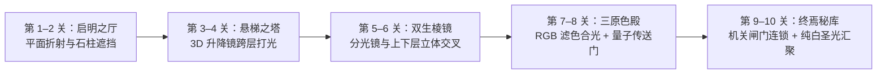

# Prism Vault · 棱镜密室 — 3D 立体光学空间解谜设计与实施方案

> 本方案严格遵循「**单 HTML 文件全内置**」原则：所有 3D 极简雕塑建筑密室、真实几何光学反射/折射/分光/混色求解引擎、实体辉光光束与焦散粒子、10 关递进关卡数据、解谜 HUD、Web Audio 空灵合成音效与中英双语系统均内置于 `games/prism.html` 单文件中，零外部模型/音频/贴图依赖，加载快且支持直接部署到 Cloudflare Workers。

---

## 1. 产品定位与核心指标

| 项目 | 规格说明 |
| --- | --- |
| **游戏名称** | **PRISM VAULT · 棱镜密室** |
| **文件路径** | `games/prism.html`（单文件自包含） |
| **核心体验** | 纪念碑谷式极简建筑美学 × 真实 3D 立体光学空间解谜：360° 自由审视多层悬浮石殿，运用反射镜、立体升降镜、分光棱镜与 RGB 混色引导光束激活圣库核心 |
| **目标平台** | 纯桌面端键鼠优先（惯性阻尼轨道视角、精准 3D 格子拾取与高度对齐辅助线、快捷键零延迟布镜与旋转） |
| **单局时长** | 10 关循序渐进完整战役，每关 0.5–2.5 分钟，全通约 **8–12 分钟**；支持任意选关与“最少元件/三星”挑战 |
| **世界尺度规范** | 统一采用真实建筑网格尺度：`1 格 = 2.0 m × 2.0 m`，每层楼高 `4.0 m`（2 格），密室主体约 `14 m × 12 m × 14 m` |
| **语言支持** | 中文 / English 实时切换，与合集首页风格一致 |

---

## 2. 精细化 3D 场景构建拆分（分层模块化架构）

为了让极简解谜空间呈现高级博物馆/纪念碑谷般的雕塑立体感，整个 3D 密室拆分为 **5 大场景构建层级**：

### 2.1 第一层：静谧天穹与空间纵深（Ambient Void）
- **渐进色温天穹（Gradient Vault Sky）**：自定义 GLSL 垂直渐变背景穹顶，随章节推进呈现 5 种高级美术氛围（晨曦象牙金 → 碧海浅青 → 暮色黛蓝 → 琥珀紫罗兰 → 终焉深邃星穹）。
- **悬浮远景方尖碑与丁达尔微尘**：密室外围 `35 m – 80 m` 散布 12–16 座极简悬浮石碑与环状石环，缓慢自转营造宏大尺度感；密室内部漂浮 300 颗缓慢布朗运动的金色微尘粒子（`Points` + 自定义柔光圆点着色器），当激光穿过区域时增强空气通透感。

### 2.2 第二层：多层极简建筑主体（Architectural Structure）
- **模块化石材体块**：所有地面平台、阶梯、悬挑廊桥与厚重方柱均采用**精细倒角边缘（Beveled Edges）**与多层装饰线脚（Molding），绝不使用生硬直角的原始 `BoxGeometry`；边缘倒角能精准捕捉天光与激光高光，是极简建筑显高级的核心秘诀。
- **镂空天井、拱门与垂直连通空间**：二层/三层地板特意留出几何天井与半圆石拱门，让玩家在旋转 360° 视角时，能直观看到激光束穿透上下楼层、掠过石柱阴影的惊艳立体构图。
- **精密黄铜嵌槽（Socket Slots）**：每个可放置光学元件的格点都雕刻有下沉式圆环石座 + 抛光黄铜刻度环 + 4 个主方向微雕指针，悬停时亮起柔和金光并投射垂直高度对齐虚线，彻底消除 3D 空间中的高度错觉。

### 2.3 第三层：光源发射器与目标接收核心（Emitters & Receivers）
- **激光发射圣柱（Beam Emitter）**：八角石基座 + 精密黄铜聚焦透镜组 + 内部脉动单色晶体，透镜前端带有微弱散射光晕。
- **目标接收核心（Vault Core）**：悬浮于黄铜四爪托架中的多面体水晶（八面体/十二面体），未激活时为半透明冷灰色，带外圈目标色温提示环（如黄色提示环代表需要红+绿合光）；被正确颜色光束击中后，水晶加速自转、内部由暗转明并伴随充能进度光环闭合。

### 2.4 第四层：六类高精度光学机械元件（Optical Instruments）
每件元件均按真实精密光学仪器比例拆分建模（底座 + 旋转阻尼转盘 + 黄铜支架 + 光学玻璃/水晶主体）：
- **水平反射镜 (Flat Mirror)**：厚重黄铜框架镶嵌高反射镀银玻璃（`metalness = 0.96, roughness = 0.04`），背面有加固肋板防止玩家误判正反面。
- **立体升降镜 (Elevation Mirror)**：带精密弧形刻度尺的 45° 倾斜镜架，清晰标示向上（↑）或向下（↓）折转方向，视觉上一眼就能读懂 3D 折射方向。
- **分光棱镜 (Beam Splitter)**：正三棱/菱形高透光物理水晶（`transmission = 0.92, ior = 1.52, thickness = 0.8`），内部可见折射光斑。
- **滤色晶体 (Chromatic Filter)**：染色光学玻璃柱，附带顶部色彩标识环。
- **光桥传送门 (Quantum Portal)**：成对双环黄铜符文拱门，内部填充流动扭曲的彩色能量薄膜着色器，配对门用相同几何符号与边色标识。
- **遮光升降闸门 (Optical Gate)**：刻有导光凹槽的厚重深青石墙，充能解锁后伴随机械阻尼平滑沉入地板。

### 2.5 第五层：实体发光光束与光学接触特效（Volumetric Beams & Caustics）
- **三层复合激光束**：每段光束由「纯白高亮度核心柱（直径 `0.06 m`）+ 饱和彩色内辉光套管（直径 `0.16 m`）+ 外层 Additive 柔和光晕（直径 `0.32 m`）」构成，确保任何视角下都清晰锐利且富有光学厚度。
- **镜面反射光斑与色散火花**：光束命中镜面/棱镜的精确交点处生成发光光斑与微弱慢速漂浮折射光点；两束光在合光点交汇时触发柔和环形波纹。

---

## 3. 真实光影、PBR 光学材质与视觉层次管线

| 渲染环节 | 具体实现参数与技术选型 |
| --- | --- |
| **建筑级自然光与软阴影** | 主暖阳方向光 `DirectionalLight`（`#fff5e4`, 强度 `2.1`）以 `42°` 黄金建筑摄影斜角照射，`2048×2048` `PCFSoftShadowMap` 紧贴 `±14 m` 密室范围，产生极其锐利干净的建筑几何投影；辅以冷青色背光补光（Rim Light）勾勒石柱暗面轮廓。 |
| **真实环境反射与玻璃折射** | `PMREMGenerator` 烘焙高动态范围天空环境贴图，供镀银镜面（清晰反射建筑与天空）、抛光黄铜（`metalness: 0.9, roughness: 0.2`）与高透光水晶棱镜（`MeshPhysicalMaterial` 开启 `transmission`, `ior: 1.52`, `clearcoat: 1.0`）使用。 |
| **程序化微颗粒石材纹理** | 离屏 Canvas 生成 512×512 细腻洞石/大理石纹理（含微孔粗糙度变化与微妙色阶过渡，`roughness: 0.78–0.88`），与高光滑黄铜/水晶形成极佳的“哑光 vs 镜面”材质对比。 |
| **光束实时环境染光** | 在关键光束反射点与已点亮的核心处挂载轻量化动态 `PointLight`（随光束颜色实时变色），让红、绿、蓝、白光束真实地将周围的象牙白石柱与地板染上对应的柔和彩光，大幅提升立体真实感！ |
| **色调映射与精致辉光** | `ACESFilmicToneMapping` + 高阈值柔和 `UnrealBloomPass`（`threshold = 0.86, strength = 0.50, radius = 0.45`），让激光束呈现电影级光学通透感而不刺眼。 |

---

## 4. 严格几何光学定律与机械运动学设计

本游戏的核心严谨性来自**100% 物理自洽的 3D 光学求解器与阻尼机械运动**：

1. **三维镜面反射定律（Law of Reflection）**：
   - 给定归一化入射光方向向量 $\vec{d}$ 与镜面法线 $\vec{n}$（如 45° 水平镜 $\vec{n} = (\pm\frac{\sqrt{2}}{2}, 0, \pm\frac{\sqrt{2}}{2})$，45° 立体升降镜 $\vec{n} = (\pm\frac{\sqrt{2}}{2}, \pm\frac{\sqrt{2}}{2}, 0)$ 等），严格按向量反射公式求解出射方向：
     $$\vec{r} = \vec{d} - 2(\vec{d} \cdot \vec{n})\vec{n}$$
   - 背面遮挡严格判定：若 $\vec{d} \cdot \vec{n} \ge 0$（光束击中镜背金属板），则吸收阻断而不穿透，符合真实镜面物理。
2. **加色法光谱混合与能量守恒（RGB Additive Optics & Conservation）**：
   - 每束光携带 3 通道光谱向量 $\vec{C} = (R, G, B) \in \{0, 1\}^3$ 与相对光强 $I \in (0, 1]$：
     - **滤色晶体**：执行按位光谱透射 $\vec{C}_{\text{out}} = \vec{C}_{\text{in}} \odot \vec{M}_{\text{filter}}$（例如红光穿过绿滤色片输出零光强，完全阻断；白光穿过红滤色片输出纯红光）。
     - **分光棱镜**：将入射光一分为二（直穿 + 90° 偏转），两束出射光光强各占 $0.5 I$（光束视觉直径微调以反映能量分流）。
     - **合光交汇**：多束光在同一接收核心或合光棱镜汇合时，光谱按加色法叠加 $\vec{C}_{\text{total}} = \min(\mathbf{1}, \sum \vec{C}_i)$（红+绿=黄、红+蓝=品红、绿+蓝=青、红+绿+蓝=纯白）。
3. **菲涅尔与斯涅尔折射视觉建模（Snell's Law & Fresnel）**：
   - 分光棱镜与核心水晶采用物理 `ior = 1.52–1.65`（冕牌玻璃/水晶折射率），根据观察角自动计算菲涅尔高光反射率 $R(\theta) = R_0 + (1 - R_0)(1 - \cos\theta)^5$，旋转视角时水晶切面闪烁真实光泽。
4. **防死循环射线追踪求解器**：
   - 采用广度优先多光束队列追踪（支持分光产生的多分支光路），单帧最多计算 32 次反弹并通过 `(cellKey, dirKey, colorMask)` 状态去重彻底杜绝传送门/双镜对射引发的无限循环。
5. **临界阻尼机械运动学（Critically Damped Springs）**：
   - 玩家按 `R` 旋转镜面 90°、元件落入石槽、遮光闸门液压升降以及轨道摄像机旋转，均由二阶临界阻尼弹簧方程 $\ddot{\theta} + 2\omega_n\dot{\theta} + \omega_n^2(\theta - \theta_{\text{target}}) = 0$（$\omega_n \approx 18\text{ rad/s}$）驱动，带来沉稳、精准、毫无晃动过冲的精密仪器手感。

---

## 5. 十关递进式战役设计

| 关卡 | 名称 | 核心机制与空间构图亮点 | 预计用时 |
| --- | --- | --- | --- |
| **01** | 初光 · First Light | 单层雅致回廊，熟悉旋转视角、放置与 90° 旋转水平镜 | 30s |
| **02** | 柱廊 · Colonnade | 3 面反射镜绕过立柱投影，体会光束被石柱遮挡的 3D 观察 | 45s |
| **03** | 跃层 · Ascent | 引入**立体升降镜**，将一层金红光束垂直打穿天井点亮二层核心 | 60s |
| **04** | 双塔 · Twin Spires | 上下两层折返反射，光束斜穿中央大拱门 | 75s |
| **05** | 分流 · Bifurcation | 引入**分光棱镜**，一束蓝光分流同时充能高低两座核心 | 75s |
| **06** | 交叉回廊 · Crossfire | 立体十字光路（一二层光束垂直立体交错，视觉极其震撼） | 90s |
| **07** | 光谱 · Spectrum | 引入 **RGB 滤色与合光**（红 + 绿 = 黄，激活双色目标核心） | 90s |
| **08** | 折射门 · Quantum Arch | 引入**光桥传送门**，将光束送入密闭顶层石室 | 100s |
| **09** | 连锁密室 · Resonance | 先分流蓝光激活机关降下遮光石闸，再让主红光穿过通道 | 120s |
| **10** | 棱镜圣殿 · The Vault | 三层宏伟悬浮神殿，汇合 RGB 三原色为**纯白圣光**开启最终圣库 | 150s |

- **防卡关与优雅体验**：支持无限次零延迟 `Z` 撤销、`Backspace` 一键重置，以及渐进式 `H` 光学提示（首次高亮 1 个关键槽位，再次点击才提示元件与朝向）。

---

## 6. 桌面端键鼠操控与 Web Audio 音效

| 操作 | 键位 | 效果说明 |
| --- | --- | --- |
| **360° 审视密室** | `右键拖拽` 或 `WASD` | 临界阻尼平滑轨道旋转，轻松观察上下楼层投影对齐 |
| **缩放视角 / 复位** | `鼠标滚轮` / `Space` | 拉近细看棱镜刻度，一键回到最佳黄金透视构图 |
| **放置 / 移动 / 回收** | `左键点击`（托盘 ↔ 槽位） | 悬停槽位显示金色黄铜边框 + 垂直对齐光柱 |
| **旋转元件角度** | `R` 或 `选中后滚轮/点击按钮` | 90° 阻尼步进旋转，每一帧实时重算整座密室光路 |
| **快捷切换元件** | `1` / `2` / `3` / `4` | 快速选用水平镜、升降镜、分光棱镜、滤色晶体 |
| **撤销 / 重置 / 提示** | `Z` / `Backspace` / `H` | 流畅试错，零弹窗打断 |

- **Web Audio 空灵音效引擎**：元件落槽的温润石材轻叩、黄铜转盘的精密机械棘轮声、光束命中不同核心时触发的**五声音阶竖琴/水晶玻璃琴和弦**（点亮核心越多，和弦越丰富饱满），以及全核心点亮过关时的空灵共鸣尾音。

---

## 7. 仓库集成与自动化验证计划

- **核心游戏文件**：`games/prism.html`
- **首页实机预览图**：`assets/previews/prism-vault.webp`（960 × 540 WebP，展示三层象牙白悬浮密室、立体石柱投影与红绿蓝交错折射光束）
- **首页集成**：更新 `index.html` 与 `README.md`
- **自动化验证脚本**：`scripts/test-prism.mjs`（`npm run test:prism`），使用 Playwright 验证：
  1. 页面零报错，第 1 关 3D 建筑密室、阴影与初始激光束正常渲染；
  2. 通过交互放置与旋转镜面，验证 3D 光学求解器正确更新光路并激活目标核心过关；
  3. 关卡切换（1–10 关）、撤销、重置、提示与中英文切换均正常；
  4. **10 关官方标准解自动求解单元测试**：在 Node/Playwright 中自动验证全部 10 关均存在可 100% 激活所有核心的有效解，彻底杜绝死关；
  5. 通过 `npm run build`、`npm run test:home` 与 `npx cf deploy --prebuilt --mode production --dry-run`。
