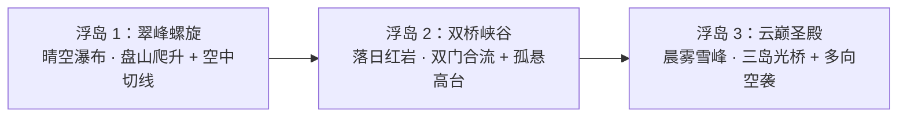

# Skyhold Bastion · 浮空要塞 — 3D 立体微缩沙盘策略塔防设计与实施方案

> 本方案严格遵循「**单 HTML 文件全内置**」原则：所有 3D 程序化浮岛地形、分层建筑与微缩植被、炮塔与敌人机械模型、PBR 程序化纹理与 GLSL 着色器、基于经典力学的弹道与运动学引擎、策略 HUD、Web Audio 合成音效与中英双语系统均内置于 `games/skyhold.html` 单文件中，零外部模型/音频/贴图依赖，加载快且支持直接部署到 Cloudflare Workers。

---

## 1. 产品定位与核心指标

| 项目 | 规格说明 |
| --- | --- |
| **游戏名称** | **SKYHOLD BASTION · 浮空要塞** |
| **文件路径** | `games/skyhold.html`（单文件自包含） |
| **核心体验** | 具有微缩实景质感（Realistic Miniature Diorama）的立体浮岛策略塔防：高地物理射程优势 + 陆空双线立体攻防 + 炮塔分支专精 + 轨道支援 |
| **目标平台** | 纯桌面端键鼠优先（阻尼轨道自由环绕视角、悬停 3D 弹道/射程预览、全快捷键高效布防） |
| **单局时长** | 单张浮岛 12 波完整战役约 **6–9 分钟**；内置 3 张差异化立体浮岛，支持冲刺三星/无伤评价 |
| **世界尺度规范** | 统一采用真实比例映射：`1 Three.js Unit = 1 米`，主浮岛直径约 `56 m`，高度跨度 `24 m`（三层阶梯高差各 `3.5 m`） |
| **语言支持** | 中文 / English 实时切换，与合集首页风格一致 |

---

## 2. 精细化 3D 场景构建拆分（分层模块化架构）

为避免网页 3D 常见的“塑料积木感”，整个浮岛世界被拆分为 **5 大场景构建层级**，每层拥有独立的几何建模逻辑、材质通道与 InstancedMesh 合批预算：

### 2.1 第一层：宏观天穹与云海环境（Macro Atmosphere）
- **物理散射天空穹顶（Sky Dome Shader）**：基于 Rayleigh + Mie 大气散射近似的自定义 GLSL 穹顶，随三张地图切换正午晴空（6500K）、落日峡谷（3200K 暖金逆光）与晨雾雪峰（7800K 清冷蓝白）。
- **多层立体云海（Volumetric-Look Cloud Deck）**：
  - 浮岛下方 `-18 m` 至 `-35 m` 处铺设双层动态噪声云海平面 + 40 组受光立体积云团（每团由 5–8 个扰动球体合批，自定义双色受光着色器：向阳面暖亮、底面蓝灰背光、边缘菲涅尔银边透射）。
  - 远景 `120 m – 260 m` 环绕分布 8–12 座低精度漂浮远山碎岛，按不同周期做极缓垂直悬浮漂移，拉出强烈的**前景—中景—远景视差纵深**。

### 2.2 第二层：立体阶梯浮岛地质与水体（Terrain & Hydrology）
- **三层阶梯岩体建模**：
  - **顶层植被台地（Lv.0 / Lv.1 / Lv.2）**：程序化生成带倒角边缘的多边形阶梯平台，顶面覆盖带微起伏顶点置换的草地/雪地/红土网格；台地边缘加装独立石砌矮墙（Parapet）与护栏桩，强化海拔边界的立体轮廓。
  - **中层风化玄武岩壁**：采用带垂直节理裂纹与水平岩层挤压的柱状岩壁网格，通过三平面/世界坐标混合着色器自动区分草坡、湿岩、干裂岩面与苔藓缝隙。
  - **底层倒锥浮石与漂浮碎岩**：浮岛底部收敛为不规则尖锥岩底，下方垂挂发光蓝晶岩脉（作为浮岛悬空的视觉动力源）及 30+ 块随慢速轨道环绕的浮空碎石（`InstancedMesh`）。
- **悬空瀑布与溪流系统**：
  - 岛顶泉眼 → 石渠引水 → 台地边缘跌落为高 `16 m` 的悬空瀑布，落入下方云海化作持续上升的水雾粒子。
  - 瀑布采用双层透明曲带网格 + GLSL 流速渐变着色器（顶部慢、底部因重力加速拉长泡沫条纹），边缘叠加碰撞白沫。

### 2.3 第三层：道路、桥梁与要塞建筑群（Infrastructure & Landmarks）
- **盘山石板路径**：沿 3D 样条曲线（`CatmullRomCurve3`）扫掠生成带路缘石（Curbstone）与路面石板接缝凹凸的连续道路，转弯处自然外倾并铺设指引路灯。
- **跨谷木石拱桥**：在峡谷与副岛间架设拱券石桥（含桥墩、扶手立柱、绳索与桥面木板纹理），增强立体穿梭感。
- **双端核心地标**：
  - **敌军传送门（Rift Gate）**：由巨型石雕符文拱门 + 旋转能量环 + 内部扭曲星云着色器构成，出怪时脉动亮起。
  - **己方水晶核心（Aether Core）**：矗立于最高台地（Lv.2）的八角石殿基座之上，由 3 层反向旋转的悬浮黄铜陀螺环包裹半透明高折射蓝色巨型水晶，随生命值降低产生裂纹与红光警报。
- **战术建造基座（Turret Pads）**：全图 18–24 个精心布设的八角形石砌基座，带黄铜镶边与内嵌高度指示灯（低谷绿灯 / 中台蓝灯 / 高地金灯），悬停时平滑浮起全息预览。

### 2.4 第四层：微观环境细节与生态点缀（Micro Props）
- **植被系统（`InstancedMesh` 合批）**：低多边形冷杉/松树（3 层锥冠 + 树干 + 顶点着色器微风摇曳）、岩缝灌木、碎石堆与发光蘑菇。
- **动态生活气息**：岛边缓慢旋转的木质风车（风叶角速度受风速驱动）、随风飘动的塔楼三角旗帜（正弦波顶点摆动）、盘旋于高空的 4–6 只程序化振翅海鸟。

### 2.5 第五层：高精可动炮塔与敌人单位（Dynamic Entities）
- **炮塔多级外观进化**：每座炮塔拆分为 `基座 → 360° 水平旋转炮台 → 独立俯仰摇架 → 可后坐炮管/发射器 → 能量核心` 五级父子节点；升级至 Lv.2 / Lv.3 时动态装配额外装甲板、双联/六联炮管与发光符文环。
- **敌人关节动画**：发条步兵带双腿交替摆动与盾牌倾斜；重甲攻城车履带纹理滚动与车体颠簸；浮空战舰带双螺旋桨高速旋转与探照灯光束。

---

## 3. 真实光影、PBR 材质与立体感渲染管线

| 渲染环节 | 具体实现参数与技术选型 |
| --- | --- |
| **主光源与真实阴影** | 主 `DirectionalLight`（暖日光 `#fff3dc`，强度 `2.4`），开启 `PCFSoftShadowMap`，阴影贴图 `2048×2048`；阴影正交视锥紧贴浮岛包围盒（`±36 m`）保证每像素约 `3.5 cm` 锐利软阴影，配合 `bias = -0.0004`、`normalBias = 0.03` 彻底消除阴影粉刺与漏光。 |
| **环境光与 IBL 反射** | 使用 `PMREMGenerator` 将每张地图的天空穹顶实时烘焙为环境贴图 `scene.environment`，让炮塔黄铜、炮管拉丝钢与水晶核心真实反射天空与落日色温；辅以 `HemisphereLight`（天光 `#8ec5fc` / 云底反射 `#d4c3a3`）避免暗面死黑。 |
| **接触阴影与立体感** | 炮塔底座、岩石、建筑与每个敌人脚下均附带径向软边接触阴影贴片（Contact AO Blob），确保单位“稳稳踩在地上”不漂浮；高台边缘加深环境遮蔽感，强化层高落差。 |
| **程序化 PBR 纹理** | 运行时用离屏 Canvas 生成 512×512 纹理集：石板法线/粗糙度图、风化岩层纹理、草地杂色与微法线、拉丝金属粗糙度图（`metalness: 0.82, roughness: 0.28`）、木纹法线图。 |
| **色调映射与克制辉光** | `THREE.ACESFilmicToneMapping`（曝光 `1.05`）+ `UnrealBloomPass`（高阈值 `threshold = 0.88`, `strength = 0.45`, `radius = 0.35`），确保辉光**只作用于**水晶核心、激光束、炮口火光、导弹尾焰与技能光柱，绝不让草地和石材泛白发糊。 |
| **大气透视与画质三档** | 远景接入轻微 `FogExp2` 拉开远山纵深；提供 `High / Med / Low` 三档画质（动态调节 DPR、阴影分辨率 `2048/1024/off` 与 Bloom 开关）。 |

---

## 4. 物理定理与运动学参数设计

所有速度、弹道、转向与反馈均遵循合理的经典物理公式，杜绝“线性平移瞬移”的廉价感：

1. **迫击炮与抛射体真实抛物线弹道**：
   - 重力加速度取真实值 $g = 9.81\text{ m/s}^2$（微缩感可微调至 $g_{\text{eff}} = 14\text{ m/s}^2$ 保证打击紧凑感）。
   - 给定炮口位置 $\vec{p}_0$、预测落点 $\vec{p}_t$ 与飞行时间 $T = \frac{d_{\text{horiz}}}{v_{\text{horiz}}}$，精确反解初始速度向量：
     $$v_{0x} = \frac{x_t - x_0}{T}, \quad v_{0z} = \frac{z_t - z_0}{T}, \quad v_{0y} = \frac{y_t - y_0 + \frac{1}{2}g_{\text{eff}}T^2}{T}$$
   - 炮弹姿态每帧严格对齐瞬时速度切线 $\vec{v}(t) = \vec{v}_0 + \vec{g}_{\text{eff}} t$，并在高地向下轰击时天然获得更长水平射程（与高地增益物理自洽）。
2. **动态提前量拦截方程（Lead-Target Prediction）**：
   - 机炮与狙击炮索敌时，联立 $\|\vec{p}_{\text{enemy}} + \vec{v}_{\text{enemy}} t - \vec{p}_{\text{turret}}\| = v_{\text{proj}} t$ 求解最小正实根 $t^*$，实现真实预瞄；高速疾风斥候在急转弯时甚至可能短暂甩开慢速弹道。
3. **转塔角速度与炮管阻尼后坐**：
   - 炮塔水平旋转受最大角速度限制（如机炮 $\omega_{\max} = 4.2\text{ rad/s}$，重型迫击炮 $\omega_{\max} = 1.6\text{ rad/s}$），带角加速度启停平滑。
   - 开火瞬间炮管沿轴向施加后坐速度，按二阶弹簧阻尼方程 $\ddot{x} + 2\zeta\omega_n \dot{x} + \omega_n^2 x = 0$（临界阻尼 $\zeta \approx 0.85$）回弹复位。
4. **坡度速度衰减与转向离心倾斜**：
   - 地面单位上坡爬升时速度按坡度角 $\theta$ 衰减：$v_{\text{actual}} = v_{\text{base}} (1 - 0.35\sin\theta)$，下坡微加速，重甲攻城车爬坡更吃力。
   - 空中无人机与浮空飞艇转弯时按向心加速度 $a_c = v^2 / R$ 计算滚转压坡角 $\phi = \arctan(k \cdot a_c / g)$，并在巡航时叠加微幅浮力简谐上下浮动。
5. **追踪导弹比例导引（Proportional Navigation）**：
   - 防空导弹并非生硬指向目标，而是按加速度 $\vec{a} = N \cdot \vec{v}_m \times \vec{\Omega}_{\text{LOS}}$ 施加最大过载限制（$a_{\max} = 28\text{ m/s}^2$），拉出优雅真实的 3D 弧线尾烟。

---

## 5. 五类可升级炮塔、主动技能与 12 波平衡

### 5.1 五类炮塔与 3 级专精分支
| 快捷键 | 炮塔名称 | 造价 | 目标 | 弹道/物理特性 | 3 级二选一专精分支 |
| --- | --- | --- | --- | --- | --- |
| `1` | **哨兵机炮塔 (Autocannon)** | 60 金 | 陆+空 | 极速预瞄弹丸（$v = 48\text{ m/s}$），高射速后坐 | **A. 加特林连射**（射速递增） **B. 穿甲狙击炮**（$v = 95\text{ m/s}$，破甲高暴击） |
| `2` | **重型迫击炮 (Mortar)** | 100 金 | 陆 | 真实高抛物线榴弹，爆炸半径 `3.8 m` | **A. 集束子母弹**（落地二次抛射 4 枚小弹） **B. 熔岩燃烧弹**（残留 4s 灼烧地表） |
| `3` | **霜晶冰塔 (Cryo Spire)** | 80 金 | 陆+空 | 360° 低温冲击环，减速 40% | **A. 极寒冻结**（周期性完全冰封 1.5s） **B. 脆冰增伤场**（范围内敌军承伤 +30%） |
| `4` | **棱光激光塔 (Prism Beam)** | 120 金 | 陆+空 | 光速瞬达持续能量束，连续锁定增伤 | **A. 过载熔毁**（单体伤害指数攀升，专克 Boss） **B. 连锁折射**（光束向邻近 3 目标跳跃） |
| `5` | **天穹导弹阵 (Skyward SAM)** | 110 金 | 优先空 | 比例导引追踪导弹，对空 200% 倍率 | **A. 六联装齐射**（多目标蜂群清扫） **B. 电磁脉冲弹**（命中飞艇引擎失速瘫痪） |

### 5.2 高地增益与主动指挥官技能
- **高地物理红利**：每升高一层（+3.5 m），射程 **+15%**、暴击率 **+10%**，悬停建造槽位时在 3D 空间内以金色双层光环标示。
- **`Q` 轨道阳炎打击**（CD 35s）：0.8 秒定位预警光柱 → 高能天基轰击，伴随扩散冲击波环与屏幕微震。
- **`E` 时空滞留力场**（CD 25s）：半径 `6 m` 半透明蓝色折射力场球，6 秒内将区域内陆空敌人移速压至 25%。

### 5.3 三张立体浮岛与 12 波敌人生态

- **7 类递进敌人**：发条步兵（W1）、疾风斥候（W2）、重甲攻城车（W4）、侦察无人机群（W5）、护盾发生器（W7）、重型浮空战舰（W9）、终极 Boss **泰坦核心 Colossus Prime**（W12，自带周期护盾与电磁脉冲干扰）。
- **风险回报**：支持 `N` 键提前召唤下一波，按剩余倒计时给予额外金币，鼓励滚雪球。

---

## 6. 桌面端键鼠操控与 Web Audio 音效

| 操作 | 键位 | 效果说明 |
| --- | --- | --- |
| **视角环绕旋转** | `右键拖拽` | 阻尼轨道平滑旋转，俯仰角限制 `18°–78°` 防止穿地 |
| **沙盘平移 / 缩放** | `中键拖拽` / `WASD` + `滚轮` | 丝滑惯性阻尼缩放（`18 m – 75 m`） |
| **建造 / 升级 / 取消** | `左键` + `1–5` / `Esc` | 选中基座弹出 3D 锚定环形面板；悬停显示真实球形射程圈 |
| **主动技能** | `Q` / `E` + `左键确认` | 3D 地面实时目标投影圈 |
| **暂停 / 倍速 / 提前出怪** | `Space` / `Tab`（1x/2x/3x）/ `N` | 战术暂停时允许完整旋转视角与建造升级 |

- **Web Audio 合成音效**：按炮塔距离摄像机远近动态衰减音量与低通滤波；覆盖机炮连点、迫击炮低频出膛与落地闷响、冰晶风铃、激光谐波、比例导引导弹点火呼啸、建造机械咔哒与 Boss 号角。

---

## 7. 仓库集成与自动化验证计划

- **核心游戏文件**：`games/skyhold.html`
- **首页实机预览图**：`assets/previews/skyhold-bastion.webp`（960 × 540 WebP，展示浮岛阶梯全景、高地炮塔火力网、抛物线炮火与悬空瀑布）
- **首页集成**：更新 `index.html` 与 `README.md`
- **自动化验证脚本**：`scripts/test-skyhold.mjs`（`npm run test:skyhold`），使用 Playwright 验证：
  1. 页面零报错，浮岛网格、瀑布着色器与阴影管线正常渲染；
  2. 点击开始进入浮岛 1，成功在基座建塔扣费，验证高地基座射程大于低谷基座；
  3. 触发第 1 波出怪，验证炮塔索敌转向、弹道发射、击杀敌人与金币增长；
  4. 验证中英文切换、画质三档、倍速与暂停功能；
  5. 通过 `npm run build`、`npm run test:home` 与 `npx cf deploy --prebuilt --mode production --dry-run`。
